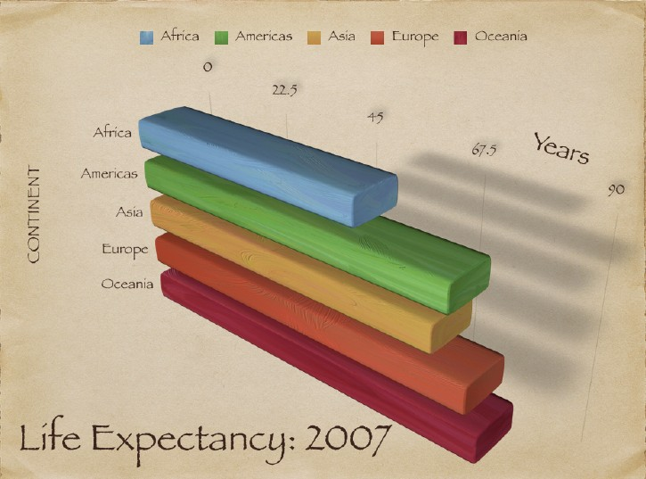
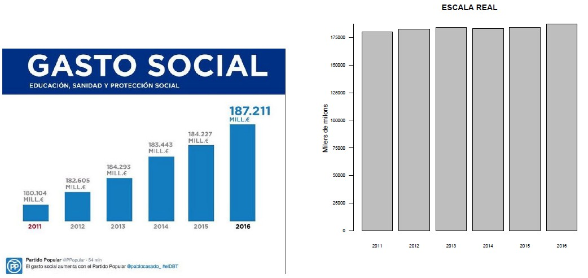
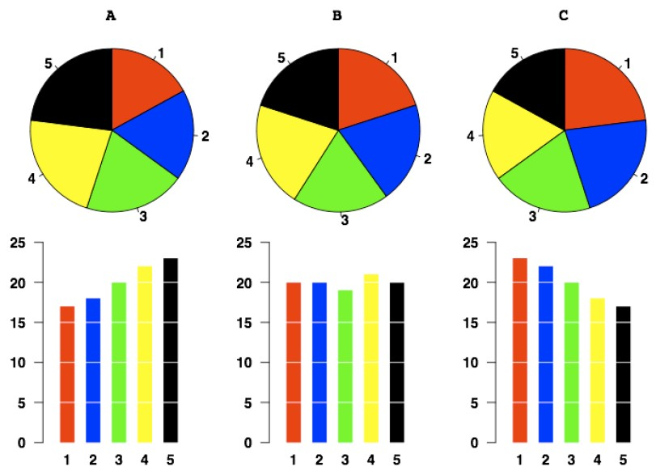
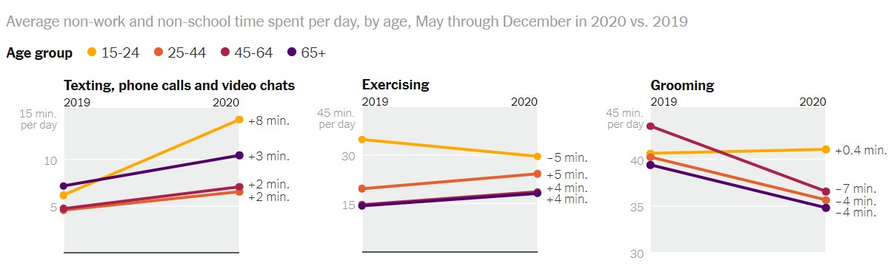
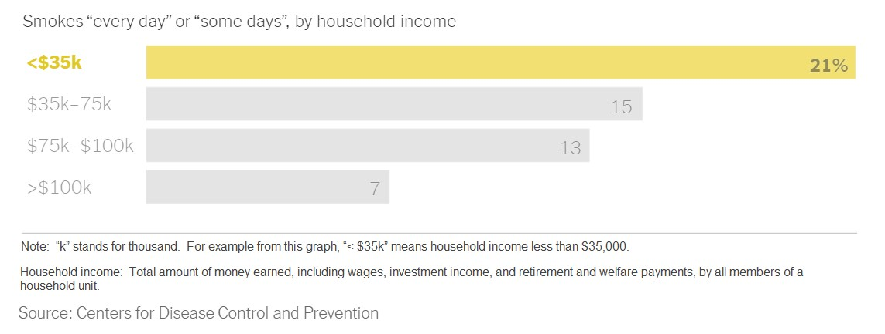

```{r}
#| label: setup
#| include: false
library(tidyverse)
options(width = 70, pillar.width = 70)
set.seed(123)

# Colors del tema (una sola tonalitat: bordeus)
bordeus      <- "#6D071A"
bordeus_clar <- "#D8A9B1"
gris_fosc    <- "#2B2B2B"

theme_set(
  theme_minimal(base_size = 20) +
    theme(panel.grid.minor = element_blank(),
          strip.text = element_text(size = 18, face = "bold", hjust = 0),
          plot.title.position = "plot")
)

# Dades netes de l'exercici de la sessió 1 (mateixos passos que la solució)
competencies <- read_csv2("dades/competencies_basiques.csv", show_col_types = FALSE) |>
  select(CODI_ALUMNE, GENERE, NATURALESA, HABITAT, PCAT, PMAT, PANG) |>
  rename(id = CODI_ALUMNE, genere = GENERE, titularitat = NATURALESA,
         habitat = HABITAT, nota_cat = PCAT, nota_mat = PMAT, nota_ang = PANG) |>
  mutate(genere = case_when(genere == "D" ~ "Dona", genere == "H" ~ "Home"),
         habitat = factor(habitat, levels = c("Fins a 10000", "De 10001 a 100000",
                                              "Més de 100000"))) |>
  filter(!is.na(nota_mat))
```

## Què farem?

:::: {.columns}

::: {.column width="50%"}
1. **Estadística descriptiva**
    - Variables categòriques
    - Variables numèriques
        - Tendència central
        - Posició
        - Dispersió
        - Forma
:::

::: {.column width="50%"}
2. **Visualització de dades**
    - Principis generals
    - Variables categòriques
    - Variables numèriques
3. **Exercici**
:::

::::

::: {.caixa-verda}
Treballarem amb les dades netes de l'exercici de la sessió 1: **`competencies`** (480 alumnes de 6è).
:::

## Què és l'estadística descriptiva?

- És el **primer pas** de tota anàlisi estadística
- Té per objectiu **resumir i presentar les dades** de manera clara i entenedora
- Ens ajuda a entendre la **distribució** i les característiques d'una o més variables
- Pot incloure:
  - Taules de freqüències
  - Mesures de tendència central i de posició (mitjana, mediana, quartils...)
  - Mesures de dispersió (rang, desviació típica, IQR)
  - Representacions gràfiques

::: {.missatge}
Abans de fer inferències o comparacions, cal conèixer bé què tenim.
:::

## Què podem fer segons el tipus de variable?

| Tipus de variable | Exemples | Mesures | Gràfics |
|---|---|---|---|
| **Nominal** | Sexe, titularitat del centre | Freqüències, proporcions, moda | Gràfica de barres |
| **Ordinal** | Grau d'acord, mida del municipi | Freqüències, proporcions (i acumulades) | Barres **ordenades** |
| **Quantitativa discreta** | Nre. de fills, cursos fets | Mitjana, mediana, desviació... | Barres o histograma, boxplot |
| **Quantitativa contínua** | Edat, notes, ingressos | Mitjana, mediana, desviació, asimetria... | Histograma, boxplot |

::: {.missatge}
El tipus de variable determina què podem fer i com ho podem interpretar.
:::

# Variables categòriques {.seccio background-color="#6D071A"}

## Descriure variables categòriques

- Comptem quants casos hi ha a cada categoria: **freqüència absoluta** (*n*) i **relativa** (%)
- En variables **ordinals**, també podem calcular la **freqüència acumulada**
- A vegades és útil **agrupar categories** poc freqüents
- En variables ordinals, cal **respectar l'ordre** de les categories (per això els factors!)

## Taules de freqüències amb R

```{r}
competencies |>
  count(habitat)
```

. . .

Afegim la freqüència **relativa** amb `mutate()`:

```{r}
competencies |>
  count(habitat) |>
  mutate(percentatge = n / sum(n) * 100)
```

## Freqüència acumulada (variables ordinals)

```{r}
competencies |>
  count(habitat) |>
  mutate(percentatge = n / sum(n) * 100,
         percentatge_acumulat = cumsum(percentatge))
```

<br>

::: {.caixa}
Com que `habitat` és un **factor ordenat**, la taula surt en l'ordre correcte i l'acumulat té sentit: el `r round(mean(competencies$habitat != "Més de 100000") * 100)` % dels alumnes estudien en municipis de 100.000 habitants o menys.
:::

# Variables numèriques {.seccio background-color="#6D071A"}

## Descriure variables numèriques

:::: {.columns}

::: {.column width="50%"}
**Tendència central**

- Mitjana, mediana, moda

**Posició**

- Quartils, percentils
:::

::: {.column width="50%"}
**Dispersió**

- Rang, desviació típica, interval interquartílic (IQR)

**Forma**

- Asimetria, curtosi
:::

::::

## Tendència central · Mitjana

:::: {.columns}

::: {.column width="55%"}
- Suma de tots els valors dividida pel nombre d'observacions:
$$\bar{x} = \frac{1}{n} \sum_{i=1}^{n} x_i$$
- És el **centre de gravetat** de la distribució
- Útil si la distribució és simètrica i sense valors atípics
- Molt **sensible als valors extrems** (outliers)
:::

::: {.column width="45%"}
::: {.caixa-verda}
**Exemple**: alçades de 5 persones (cm): 165, 170, 172, 168, **210**
:::

```{r}
alcades <- c(165, 170, 172, 168, 210)
mean(alcades)
```

::: {.petit .gris}
La mitjana està influïda per l'alçada extrema de 210 cm.
:::
:::

::::

## Tendència central · Mediana

- **Valor central** de la distribució ordenada
- Amb un nombre parell d'observacions: mitjana dels dos valors centrals
- **No es veu afectada** per valors extrems: és una mesura **robusta**

::: {.caixa-verda}
**Exemple**: alçades ordenades: 165, 168, **170**, 172, 210
:::

```{r}
median(alcades)
```

## Mitjana o mediana?

```{r}
#| code-fold: true
#| fig-width: 11
#| fig-height: 4.4
mitjana <- mean(competencies$nota_ang, na.rm = TRUE)
mediana <- median(competencies$nota_ang, na.rm = TRUE)

ggplot(competencies, aes(x = nota_ang)) +
  geom_histogram(binwidth = 5, boundary = 0, fill = bordeus_clar, color = "white") +
  geom_vline(xintercept = mitjana, color = bordeus, linetype = "dashed", linewidth = 1) +
  geom_vline(xintercept = mediana, color = gris_fosc, linetype = "dotted", linewidth = 1) +
  annotate("text", x = mitjana - 1, y = Inf, vjust = 1.5, hjust = 1, color = bordeus,
           label = paste("Mitjana:", round(mitjana, 1)), size = 5) +
  annotate("text", x = mediana + 1, y = Inf, vjust = 1.5, hjust = 0, color = gris_fosc,
           label = paste("Mediana:", round(mediana, 1)), size = 5) +
  labs(x = "Puntuació d'anglès (0-100)", y = "Nombre d'alumnes")
```

::: {.petit}
Les notes d'anglès tenen una **cua a l'esquerra** (alguns alumnes amb notes molt baixes): la mitjana queda per sota de la mediana.
:::

## Tendència central · Moda

:::: {.columns}

::: {.column width="55%"}
- El valor **més freqüent**
- Pot haver-hi més d'una moda, o cap
- Útil en dades **categòriques** o **discretes**; poc informativa en dades contínues
- R no té una funció per a la moda: la trobem amb `count()`
:::

::: {.column width="45%"}
::: {.caixa-verda}
**Exemple**: nombre de cursos fets: 1, 2, 2, 2, 3, 4 → **moda = 2**
:::

```{r}
tibble(cursos = c(1, 2, 2, 2, 3, 4)) |>
  count(cursos)
```
:::

::::

## Posició · Quartils i percentils

:::: {.columns}

::: {.column width="55%"}
- **Quartils**: divideixen les dades ordenades en **4 parts iguals**
  - $Q_1$: deixa per sota el 25 %
  - $Q_2$ = **mediana** (50 %)
  - $Q_3$: deixa per sota el 75 %
- **Percentils**: divideixen les dades en **100 parts**
  - $P_{25} = Q_1$, $P_{50}$ = mediana, $P_{75} = Q_3$
  - Estar al percentil 80 vol dir superar el 80 % de les persones
:::

::: {.column width="45%"}
```{r}
quantile(competencies$nota_cat,
         na.rm = TRUE)
```

```{r}
quantile(competencies$nota_cat,
         probs = c(0.1, 0.9),
         na.rm = TRUE)
```
:::

::::

## Dispersió

- Les mesures de tendència central **no diuen res sobre la variabilitat**
- Dues variables poden tenir la **mateixa mitjana** però una dispersió molt diferent
- Les mesures de dispersió ens informen de com s'**escampen** els valors

::: {.missatge}
Conèixer només la mitjana pot portar a interpretacions enganyoses.
:::

## Dispersió · Desviació típica

- Mesura la **distància mitjana** de les dades respecte de la mitjana
- Petita → dades **agrupades** al voltant de la mitjana
- Gran → dades més **escampades** o amb valors extrems
- Molt útil, però **sensible als outliers**

::: {.caixa-verda}
**Exemple**: si la mitjana d'edat és 40 anys i la desviació típica és 5, la majoria de valors estan entre 35 i 45 anys.
:::

## Dispersió · Desviació típica

```{r}
#| code-fold: true
#| fig-width: 11
#| fig-height: 3.9
set.seed(123)
dades_sd <- bind_rows(
  tibble(valor = rnorm(10000, sd = 0.5), grup = "Desviació típica = 0,5"),
  tibble(valor = rnorm(10000, sd = 1),   grup = "Desviació típica = 1"),
  tibble(valor = rnorm(10000, sd = 2),   grup = "Desviació típica = 2")
) |>
  mutate(grup = factor(grup, levels = unique(grup)))

ggplot(dades_sd, aes(x = valor)) +
  geom_histogram(aes(y = after_stat(density)), bins = 60, fill = bordeus_clar, color = "white") +
  geom_vline(xintercept = 0, color = bordeus, linetype = "dashed", linewidth = 1) +
  facet_wrap(~ grup, ncol = 3) +
  coord_cartesian(xlim = c(-5, 5)) +
  labs(x = NULL, y = "Densitat")
```

::: {.petit .centre}
Normals amb **mitjana 0** i diferent desviació típica
:::

## Dispersió · Com es calcula la desviació típica

:::: {.columns}

::: {.column width="50%"}
$$s = \sqrt{\frac{1}{n-1} \sum_{i=1}^{n} (x_i - \bar{x})^2}$$

Alçades: 160, 170, 180, 165, 175 → $\bar{x} = 170$

| $x_i$ | $x_i - \bar{x}$ | $(x_i - \bar{x})^2$ |
|:---:|:---:|:---:|
| 160 | −10 | 100 |
| 170 | 0 | 0 |
| 180 | 10 | 100 |
| 165 | −5 | 25 |
| 175 | 5 | 25 |
| **Suma** | **0** | **250** |
:::

::: {.column width="50%"}
$$s = \sqrt{\frac{250}{5 - 1}} = \sqrt{62{,}5} \approx 7{,}91$$

```{r}
alcades2 <- c(160, 170, 180, 165, 175)
sd(alcades2)
```

::: {.caixa}
R divideix per $n-1$ (desviació **mostral**), que és el que fem servir quan les dades són una mostra. Si fossin tota la població, dividiríem per $n$: $\sqrt{250/5} \approx 7{,}07$.
:::
:::

::::

## Dispersió · Rang i interval interquartílic

:::: {.columns}

::: {.column width="50%"}
### Rang
- Màxim − mínim
- Molt senzill, però **molt sensible** als extrems

```{r}
range(alcades)
max(alcades) - min(alcades)
```
:::

::: {.column width="50%"}
### Interval interquartílic (IQR)
- $Q_3 - Q_1$: dispersió del **50 % central** de les dades
- **Robust**: poc afectat pels extrems
- És l'alçada de la caixa del boxplot

```{r}
IQR(alcades)
```
:::

::::

## Tot de cop: `summary()`

```{r}
summary(competencies$nota_cat)
```

. . .

O diverses mesures alhora, a la nostra manera:

```{r}
competencies |>
  summarise(mitjana = mean(nota_cat, na.rm = TRUE),
            mediana = median(nota_cat, na.rm = TRUE),
            desv_tipica = sd(nota_cat, na.rm = TRUE),
            iqr = IQR(nota_cat, na.rm = TRUE),
            n = n())
```

::: {.petit .gris}
`summarise()` resumeix moltes files en una sola. Hi tornarem a la sessió 3 per comparar grups.
:::

## Forma

- Fins ara: **mitjana** i **desviació típica**
- Però dues distribucions poden tenir la mateixa mitjana i desviació i ser **molt diferents**

::: {.caixa}
**Com ho detectem?** Mirant la **forma** de la distribució:

- **Asimetria**: és simètrica o està desplaçada cap a un costat?
- **Curtosi**: quant pes tenen les cues (els valors extrems)?
:::

::: {.missatge}
I, sobretot, **fent un gràfic**!
:::

## Forma · Asimetria

:::: {.columns}

::: {.column width="50%"}
- **0**: simètrica (p. ex. normal)
- **Positiva**: cua llarga cap a la **dreta** (valors extrems alts, p. ex. ingressos)
- **Negativa**: cua llarga cap a l'**esquerra** (valors extrems baixos)

$$\text{Asimetria} = \frac{1}{n} \sum \left(\frac{x_i - \bar{x}}{s}\right)^3$$

```{r}
x <- competencies$nota_ang
x <- x[!is.na(x)]
mean(((x - mean(x)) / sd(x))^3)
```
:::

::: {.column width="50%"}
```{r}
#| code-fold: true
#| fig-width: 6
#| fig-height: 4.7
set.seed(123)
n <- 10000
dades_asim <- bind_rows(
  tibble(valor = as.numeric(scale(rnorm(n))), grup = "Simètrica"),
  tibble(valor = as.numeric(scale(rlnorm(n, sdlog = 0.5))), grup = "Asimetria positiva"),
  tibble(valor = as.numeric(scale(-rlnorm(n, sdlog = 0.5))), grup = "Asimetria negativa")
) |>
  mutate(grup = factor(grup, levels = unique(grup)))

ggplot(dades_asim, aes(x = valor)) +
  geom_histogram(aes(y = after_stat(density)), bins = 40, fill = bordeus_clar, color = "white") +
  facet_wrap(~ grup, ncol = 1) +
  coord_cartesian(xlim = c(-3, 3)) +
  labs(x = NULL, y = NULL) +
  theme(axis.text.y = element_blank())
```
:::

::::

## Forma · Curtosi

:::: {.columns}

::: {.column width="50%"}
- Mesura quant **pes tenen les cues**
- Una normal té curtosi **3**
- **Alta**: més valors extrems (més punxeguda)
- **Baixa**: distribució més plana

$$\text{Curtosi} = \frac{1}{n} \sum \left(\frac{x_i - \bar{x}}{s}\right)^4$$

```{r}
mean(((x - mean(x)) / sd(x))^4)
```

::: {.petit .gris}
Sovint es dona la curtosi **centrada** (curtosi − 3), per comparar-la directament amb la normal.
:::
:::

::: {.column width="50%"}
```{r}
#| code-fold: true
#| fig-width: 6
#| fig-height: 4.7
set.seed(123)
n <- 100000
dades_curt <- bind_rows(
  tibble(valor = as.numeric(scale(runif(n))), grup = "Curtosi baixa (plana)"),
  tibble(valor = as.numeric(scale(rnorm(n))), grup = "Curtosi normal"),
  tibble(valor = as.numeric(scale(rt(n, df = 5))), grup = "Curtosi alta (cues llargues)")
) |>
  mutate(grup = factor(grup, levels = unique(grup)))

ggplot(dades_curt, aes(x = valor)) +
  geom_histogram(aes(y = after_stat(density)), bins = 60, fill = bordeus_clar, color = "white") +
  facet_wrap(~ grup, ncol = 1) +
  coord_cartesian(xlim = c(-4, 4)) +
  labs(x = NULL, y = NULL) +
  theme(axis.text.y = element_blank())
```
:::

::::

# Visualització de dades {.seccio background-color="#6D071A"}

## Principis de visualització de dades

L'objectiu d'un gràfic és **comunicar** la informació de forma clara i intuïtiva.

:::: {.columns}

::: {.column width="50%"}
### Bones pràctiques
- **Simplicitat**: no sobrecarregar el gràfic
- **Precisió**: no distorsionar la informació
- **Context**: títols, eixos i fonts clars
:::

::: {.column width="50%"}
### Evitar
- Gràfics en **3D** innecessaris
- Colors estridents o molts estils barrejats
- **Tallar l'eix Y** en gràfiques de barres
- Gràfics de **sectors** (formatgets)
:::

::::

## Exemples {.centre}

{height="560"}

## Exemples {.centre}

{height="560"}

## Exemples {.centre}

{height="560"}

## Exemples {.centre}

{height="560"}

## Exemples {.centre}

{height="560"}

## Gràfics amb R: `ggplot2`

Un gràfic de `ggplot2` es construeix **per capes**, unides amb `+`:

```{r}
#| eval: false
ggplot(dades, aes(x = variable)) +   # 1. Dades i quina variable va a cada eix
  geom_bar() +                       # 2. Tipus de gràfic (geometria)
  labs(x = "Títol de l'eix X",       # 3. Etiquetes
       y = "Títol de l'eix Y")
```

<br>

| Gràfic | Geometria |
|---|---|
| Barres | `geom_bar()` |
| Histograma | `geom_histogram()` |
| Diagrama de caixa | `geom_boxplot()` |
| Violí | `geom_violin()` |

::: {.petit .gris}
Atenció: entre capes de `ggplot` es fa servir `+`, no `|>`.
:::

## Variables categòriques · Gràfica de barres

:::: {.columns}

::: {.column width="40%"}
- La millor opció per a variables categòriques
- Freqüència **absoluta** o **relativa** de cada categoria
- Si són **ordinals**, respectar l'ordre
- Ni sectors ni 3D
:::

::: {.column width="60%"}
```{r}
#| fig-width: 7
#| fig-height: 3.7
ggplot(competencies, aes(x = habitat)) +
  geom_bar(fill = bordeus, width = 0.6) +
  labs(x = "Mida del municipi",
       y = "Nombre d'alumnes")
```
:::

::::

## Variables numèriques · Histograma

:::: {.columns}

::: {.column width="40%"}
- Mostra com es **distribueixen** els valors
- Agrupa les observacions en **intervals** (*bins*)
- Permet veure tendència central, dispersió i forma
- **Compte**: el nombre d'intervals canvia la forma que veiem!
:::

::: {.column width="60%"}
```{r}
#| fig-width: 7
#| fig-height: 3.7
ggplot(competencies, aes(x = nota_cat)) +
  geom_histogram(binwidth = 5, boundary = 0,
                 fill = bordeus_clar,
                 color = "white") +
  labs(x = "Puntuació de català",
       y = "Nombre d'alumnes")
```
:::

::::

## Histograma · Importància del nombre d'intervals

```{r}
#| code-fold: true
#| fig-width: 12
#| fig-height: 3.8
set.seed(12345)
x_bins <- rnorm(1000)
nivells <- c("6 intervals", "25 intervals", "150 intervals")
d6   <- tibble(valor = x_bins, bins = factor("6 intervals",   levels = nivells))
d25  <- tibble(valor = x_bins, bins = factor("25 intervals",  levels = nivells))
d150 <- tibble(valor = x_bins, bins = factor("150 intervals", levels = nivells))
corba <- tibble(valor = rep(seq(-3, 3, length.out = 200), 3),
                bins  = factor(rep(nivells, each = 200), levels = nivells),
                densitat = dnorm(valor))

ggplot(mapping = aes(x = valor, y = after_stat(density))) +
  geom_histogram(data = d6,   bins = 6,   fill = bordeus_clar, color = NA) +
  geom_histogram(data = d25,  bins = 25,  fill = bordeus_clar, color = NA) +
  geom_histogram(data = d150, bins = 150, fill = bordeus_clar, color = NA) +
  geom_line(data = corba, aes(x = valor, y = densitat), color = bordeus, linewidth = 1) +
  facet_wrap(~ bins, ncol = 3) +
  coord_cartesian(xlim = c(-3, 3)) +
  labs(x = NULL, y = "Densitat")
```

::: {.petit .centre}
Les mateixes 1.000 dades amb 6, 25 i 150 intervals. La línia és la distribució real.
:::

## Variables numèriques · Diagrama de caixa (boxplot)

:::: {.columns}

::: {.column width="45%"}
**Representa**

- **Mediana** (línia central)
- **Quartils** $Q_1$ i $Q_3$ (la caixa)
- **IQR** (l'alçada de la caixa)
- **Bigotis**: fins a 1,5 · IQR
- **Outliers**: punts més enllà dels bigotis

**Detecta** asimetria, dispersió i valors atípics
:::

::: {.column width="55%"}
```{r}
#| code-fold: true
#| fig-width: 6.5
#| fig-height: 4.5
set.seed(123)
xb <- c(rnorm(99), 3.5)
q <- quantile(xb, c(0.25, 0.5, 0.75)); iqr <- q[3] - q[1]
bigoti_sup <- max(xb[xb <= q[3] + 1.5 * iqr]); bigoti_inf <- min(xb[xb >= q[1] - 1.5 * iqr])

ggplot(tibble(valor = xb), aes(x = 0, y = valor)) +
  geom_boxplot(fill = bordeus_clar, width = 0.5, outlier.size = 3) +
  annotate("text", x = 0.3, y = c(q, bigoti_sup, bigoti_inf, 3.5),
           label = c("Q1", "Mediana", "Q3", "Bigoti superior", "Bigoti inferior", "Outlier"),
           hjust = 0, size = 5) +
  annotate("segment", x = -0.33, xend = -0.33, y = q[1], yend = q[3],
           arrow = arrow(ends = "both", length = unit(0.1, "in"))) +
  annotate("text", x = -0.37, y = q[2], label = "IQR", angle = 90, size = 5) +
  coord_cartesian(xlim = c(-0.5, 0.8)) +
  labs(x = NULL, y = NULL) +
  theme(axis.text = element_blank(), panel.grid = element_blank())
```
:::

::::

## Boxplot · Dispersió, asimetria i curtosi

```{r}
#| code-fold: true
#| fig-width: 12
#| fig-height: 4.4
set.seed(123)
nb <- 200
bind_rows(
  tibble(valor = rnorm(nb, sd = 0.5), tipus = "Dispersió baixa", grup = "Dispersió"),
  tibble(valor = rnorm(nb, sd = 2),   tipus = "Dispersió alta",  grup = "Dispersió"),
  tibble(valor = as.numeric(scale(rlnorm(nb, sdlog = 0.7))),  tipus = "Asim. positiva", grup = "Asimetria"),
  tibble(valor = as.numeric(scale(-rlnorm(nb, sdlog = 0.7))), tipus = "Asim. negativa", grup = "Asimetria"),
  tibble(valor = as.numeric(scale(runif(nb))),       tipus = "Curtosi baixa", grup = "Curtosi"),
  tibble(valor = as.numeric(scale(rt(nb, df = 2))),  tipus = "Curtosi alta",  grup = "Curtosi")
) |>
  mutate(tipus = factor(tipus, levels = unique(tipus)),
         grup = factor(grup, levels = unique(grup))) |>
  ggplot(aes(x = tipus, y = valor)) +
  geom_boxplot(fill = bordeus_clar, width = 0.6) +
  facet_wrap(~ grup, scales = "free_x") +
  labs(x = NULL, y = NULL)
```

## Boxplot i violí amb R

:::: {.columns}

::: {.column width="50%"}
```{r}
#| fig-width: 6
#| fig-height: 3.2
ggplot(competencies,
       aes(x = "", y = nota_cat)) +
  geom_boxplot(fill = bordeus_clar,
               width = 0.4) +
  labs(x = NULL,
       y = "Puntuació de català")
```
:::

::: {.column width="50%"}
```{r}
#| fig-width: 6
#| fig-height: 3.2
ggplot(competencies,
       aes(x = "", y = nota_cat)) +
  geom_violin(fill = bordeus_clar) +
  geom_boxplot(width = 0.1) +
  labs(x = NULL,
       y = "Puntuació de català")
```
:::

::::

::: {.petit}
El **violí** mostra la **densitat**; el boxplot del mig, el resum numèric.
:::

# Exercici {.seccio background-color="#6D071A"}

## Exercici de descripció de dades

::: {.caixa}
**Objectiu**: fer una descripció completa de dues variables de `dades/competencies.csv`, les dades de la sessió 1 ja netes (part A de `codi/exercici_sessio_2.R`).
:::

:::: {.columns}

::: {.column width="50%"}
**1. Variable categòrica: `habitat`**

- Importeu les dades i torneu a convertir `habitat` en factor ordenat
- Freqüències absolutes, relatives i acumulades: `count()` + `mutate()`
- Gràfica de barres: `geom_bar()`
:::

::: {.column width="50%"}
**2. Variable numèrica: `nota_cat`**

- Tendència central, posició i dispersió: `summary()`, `sd()`, `IQR()`, `quantile()`
- Forma: asimetria i curtosi
- Histograma i boxplot: `geom_histogram()`, `geom_boxplot()`
:::

::::

**Comenteu els resultats en tot moment** (amb `#` a l'script)!

::: notes
El CSV no conserva l'ordre dels factors: cal tornar a fer `mutate(habitat = factor(...))` després d'importar. Lliurament: l'script .R comentat.
:::
