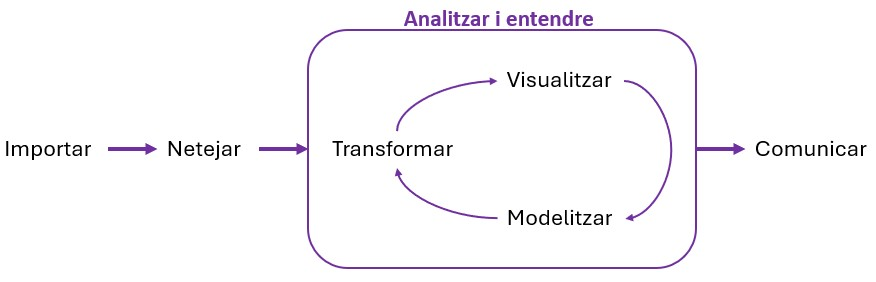

```{r}
#| label: setup
#| include: false
library(tidyverse)
options(width = 70, pillar.width = 70)
```

# Benvinguda {.seccio background-color="#6D071A"}

::: notes
**9:30 – 9:50 (20')** Benvinguda, presentacions i estructura del curs.
:::

## Benvinguda i presentacions

:::: {.columns}

::: {.column width="50%"}
### Joel Ardiaca

- Estadístic i sociòleg
- Analista de dades al **Centre d'Estudis d'Opinió (CEO)**
- Faig servir R cada dia per treballar amb enquestes
:::

::: {.column width="50%"}
### I vosaltres?

- Nom
- Lloc de feina
- Què us agradaria treure del curs?
- Coneixements previs d'estadística
- Heu programat mai? (R, Python, macros d'Excel, SPSS...)
:::

::::

::: notes
Ronda oral de presentacions (~1' per persona). Apuntar qui té experiència prèvia amb R o programació: poden ajudar els companys durant les pràctiques.
:::

## Estructura del curs

| Sessió | Data | Contingut |
|:------:|------|-----------|
| **1** | Dl. 19 d'octubre | Introducció a l'estadística. **R i RStudio**: tipus de dades, importar i netejar dades |
| **2** | Dt. 27 d'octubre | Estadística **descriptiva** i **inferencial** univariada: intervals de confiança i contrastos d'hipòtesis |
| **3** | Dl. 2 de novembre | Estadística **bivariada**: taules de contingència, prova χ² i comparació de mitjanes |
| **4** | Dl. 9 de novembre | **Correlació** i **regressió** lineal |

: {tbl-colwidths="[10,22,68]"}

<br>

- 4 sessions de 4 hores (9:30 – 13:30), amb una **pausa** a mitja sessió
- Tot el curs el farem amb **R i RStudio**, amb **dades reals**

## Metodologia i avaluació

:::: {.columns}

::: {.column width="50%"}
### Metodologia

- Explicació dels **conceptes** estadístics
- Demostració en directe amb **R**
- **Pràctica**: exercicis curts durant la sessió i un exercici final
:::

::: {.column width="50%"}
### Avaluació

- Avaluació **continuada**
- Lliurament de l'**exercici pràctic** de cada sessió, per **correu electrònic**
- Assistència mínima del **75 %** per obtenir el certificat
:::

::::

::: {.caixa}
L'objectiu no és memoritzar codi: és **entendre què fem amb les dades** i **interpretar** bé els resultats.
:::

## Què farem avui?

:::: {.columns}

::: {.column width="50%"}
**Abans de la pausa**

1. Què és l'estadística i conceptes bàsics
2. Què és R i què és RStudio
3. Primers passos amb R: objectes, funcions i tipus de dades
:::

::: {.column width="50%"}
**Després de la pausa**

4. El tidyverse i les seves funcions principals
5. Demo: importar, netejar i exportar dades
6. Codi en l'era de la IA
7. **Exercici**: preparar una base de dades
:::

::::

# Què és l'estadística? {.seccio background-color="#6D071A"}

::: notes
**9:50 – 10:15 (25')** Motivació, cicle d'anàlisi, 3 grans blocs i conceptes bàsics.
:::

## Per què és important l'estadística avui dia?

Tenim **més dades que mai** i més capacitat per recollir-les, organitzar-les i analitzar-les.

. . .

::: {.caixa}
**Però...** tenir dades no equival a tenir **informació** ni **coneixement**.
:::

. . .

L'estadística és l'eina que ens permet extreure informació valuosa de les dades, per **entendre el món** i **prendre millors decisions**.

::: notes
Exemples de l'Administració: avaluar un servei, construir indicadors, decidir on es destinen recursos, interpretar una enquesta.
:::

## Cicle d'anàlisi de les dades

{fig-align="center" width="85%"}

::: {.centre .petit}
Avui: **importar** i **netejar** · Sessions 2–4: **visualitzar**, **modelitzar** i **comunicar**
:::

::: notes
Adaptat de *R for Data Science* (Wickham). Remarcar que la major part del temps real d'un projecte d'anàlisi se'n va en importar i netejar.
:::

## Els 3 grans blocs de l'estadística

:::: {.columns}

::: {.column width="32%"}
::: {.bloc .fragment}
### 1. Descriptiva

**Resumir i presentar** les dades de manera clara.

- Mitjana, mediana, desviació...
- Taules i gràfics

*Ex.: edat mitjana de les persones usuàries d'un servei*

**Sessions 1–2**
:::
:::

::: {.column width="2%"}
:::

::: {.column width="32%"}
::: {.bloc .fragment}
### 2. Inferencial

Treure **conclusions sobre una població** a partir d'una mostra.

- Intervals de confiança
- Contrastos d'hipòtesis

*Ex.: amb 1.000 entrevistes, estimar el suport a una política*

**Sessió 2**
:::
:::

::: {.column width="2%"}
:::

::: {.column width="32%"}
::: {.bloc .fragment}
### 3. Relacions i models

**Relacionar** variables, **explicar** o **predir**.

- Taules de contingència, χ²
- Correlació i regressió

*Ex.: com influeixen els estudis i l'edat en la satisfacció amb un servei públic*

**Sessions 3–4**
:::
:::

::::

## Població i mostra

- **Població**: conjunt complet d'individus o elements sobre els quals volem obtenir informació
- **Mostra**: subconjunt d'individus seleccionats de la població

::: {.caixa-verda}
**Exemple** <br>
Població: la ciutadania de Catalunya <br>
Mostra: 2.000 persones entrevistades pel CEO
:::

. . .

L'estadística inferencial ens permet extreure conclusions sobre la població a partir de la mostra, **amb una certa incertesa** (marge d'error).

## Unitats d'anàlisi

- La **unitat d'anàlisi** és cada element del qual recollim dades: **una fila** de la base de dades
- Cal distingir-la del **nivell d'anàlisi**: el nivell al qual volem treure conclusions

::: {.caixa-verda}
**Exemple** <br>
Tenim dades de persones (unitat d'anàlisi: persona), però volem treure conclusions per províncies: canviem el **nivell** d'anàlisi agregant les dades.
:::

. . .

::: {.missatge}
Una fila = una unitat d'anàlisi. Ho tornarem a veure quan treballem amb R.
:::

## Tipus de variables

:::: {.columns}

::: {.column width="50%"}
### Categòriques (qualitatives)

- **Nominals**: sense ordre <br> [sexe, municipi, titularitat del centre...]{.gris}
- **Ordinals**: amb ordre <br> [grau d'acord, nivell d'estudis, molt / bastant / poc / gens...]{.gris}
:::

::: {.column width="50%"}
### Quantitatives (numèriques)

- **Discretes**: valors comptables <br> [nombre de fills, nombre de trucades...]{.gris}
- **Contínues**: qualsevol valor en un interval <br> [ingressos, temps de resposta, edat...]{.gris}
:::

::::

::: {.missatge}
El tipus de variable determina quina anàlisi podem fer!
:::

## Quin tipus de variable és? {.el-teu-torn}

| Variable | Tipus |
|----------|-------|
| Comarca de residència | [Categòrica nominal]{.fragment .resposta} |
| Satisfacció amb el servei (molt / bastant / poc / gens) | [Categòrica ordinal]{.fragment .resposta} |
| Nombre de persones a la llar | [Quantitativa discreta]{.fragment .resposta} |
| Temps d'espera (minuts) | [Quantitativa contínua]{.fragment .resposta} |
| Simpatia cap a la UE (escala 0–10) | [Quantitativa discreta (o ordinal!)]{.fragment .resposta} |
| Codi postal | [Categòrica nominal (encara que siguin números!)]{.fragment .resposta} |

::: notes
Preguntar a la classe abans de mostrar cada resposta. Les dues últimes generen debat: una escala 0–10 sovint es tracta com a quantitativa; un codi postal té números però no té sentit fer-ne la mitjana.
:::

## Qualitat de les dades

Abans d'analitzar, cal revisar:

- **Valors perduts**: cel·les buides, codis com `99` o `9999`, "No ho sap / No contesta"
- **Codificacions** incorrectes o inconsistents
- **Etiquetes** errònies o confuses
- Dades **duplicades** o inconsistents
- **Errors d'entrada** o unitats barrejades

. . .

::: {.caixa}
Una bona neteja evita biaixos i conclusions errònies. **Avui aprendrem a fer-la amb R.**
:::

# R i RStudio {.seccio background-color="#6D071A"}

::: notes
**10:15 – 10:40 (25')** Què és R, R vs RStudio, instal·lació, els 4 panells, scripts i projectes. Tenir RStudio obert per ensenyar-ho en directe.
:::

## Què és R?

:::: {.columns}

::: {.column width="60%"}
- Un **llenguatge de programació** pensat per a l'estadística i l'anàlisi de dades
- **Gratuït** i de **codi obert**
- Milers de **paquets** que n'amplien les funcions
- Una comunitat molt gran: hi ha resposta per a gairebé tot
- Molt utilitzat a universitats, centres de recerca, instituts d'estadística i administracions
:::

::: {.column width="40%"}
::: {.caixa}
**Per què programar?**

El codi és la **recepta** de l'anàlisi:

- Queda escrit què hem fet
- Es pot **repetir** amb dades noves
- Es pot **compartir** i revisar
:::
:::

::::

## R comparat amb altres eines

| | Excel | SPSS / Jamovi | **R** |
|---|:---:|:---:|:---:|
| Cost | Llicència | Llicència / Gratuït | **Gratuït** |
| Forma de treballar | Clics i fórmules | Menús | **Codi** |
| Reproduïble | Difícil | Parcialment | **Sí** |
| Volum de dades | Limitat | Mitjà | **Gran** |
| Gràfics personalitzats | Limitats | Limitats | **Molt flexibles** |
| Corba d'aprenentatge | Suau | Suau | **Més pronunciada** |

::: {.missatge}
El preu inicial és aprendre a escriure codi. Avui comencem!
:::

::: notes
Jamovi (el programa que fèiem servir l'any passat) està construït sobre R: tot el que fa Jamovi es pot fer amb R.
:::

## R i RStudio: el motor i el tauler

:::: {.columns}

::: {.column width="50%"}
### R
::: {.caixa}
El **motor**: el programa que fa els càlculs.

Es pot fer servir sol, però és poc còmode.
:::
:::

::: {.column width="50%"}
### RStudio
::: {.caixa-verda}
El **tauler de comandament**: l'entorn on escrivim el codi, veiem les dades, els gràfics i l'ajuda.

Necessita R instal·lat per funcionar.
:::
:::

::::

**Instal·lació** (en aquest ordre): **1.** R ([cran.r-project.org](https://cran.r-project.org)) · **2.** RStudio Desktop ([posit.co](https://posit.co/download/rstudio-desktop/))

::: {.petit .gris}
Alternativa sense instal·lar res: **Posit Cloud** ([posit.cloud](https://posit.cloud)), RStudio al navegador.
:::

::: notes
Si els ordinadors de l'aula no tenen R/RStudio, seguir la guia d'instal·lació de la web del curs (pàgina "Abans de començar"). Pla B: `sessio-1/guies/guia_posit_cloud.html` (només professor).
:::

## RStudio: els 4 panells

::: {.panells}

::: {.panell}
[1 · Script (editor)]{.panell-titol}

On **escrivim i desem** el codi (`.R`).

Executem amb <kbd>Ctrl</kbd> + <kbd>Enter</kbd>.
:::

::: {.panell}
[3 · Entorn (Environment)]{.panell-titol}

Els **objectes** que tenim creats: dades, vectors, resultats...
:::

::: {.panell}
[2 · Consola]{.panell-titol}

On R **executa** el codi i mostra els resultats.

Es pot escriure directament, però no es desa.
:::

::: {.panell}
[4 · Fitxers / Gràfics / Paquets / Ajuda]{.panell-titol}

Navegador de **fitxers**, **gràfics** generats, **paquets** instal·lats i **ajuda** de les funcions.
:::

:::

::: notes
Obrir RStudio i assenyalar cada panell. Si l'script no apareix: File > New File > R Script.
:::

## Script o consola?

:::: {.columns}

::: {.column width="50%"}
### Consola
- S'executa al moment
- **No es desa**
- Útil per a proves ràpides
:::

::: {.column width="50%"}
### Script (`.R`)
- Es **desa** en un fitxer
- Es pot tornar a executar
- **Sempre treballarem amb scripts**
:::

::::

| Drecera | Què fa |
|---------|--------|
| <kbd>Ctrl</kbd> + <kbd>Enter</kbd> | Executa la línia (o la selecció) |
| <kbd>Alt</kbd> + <kbd>-</kbd> | Escriu `<-` |
| <kbd>Ctrl</kbd> + <kbd>Shift</kbd> + <kbd>M</kbd> | Escriu el pipe `|>` |
| <kbd>Tab</kbd> | Autocompleta noms de funcions i objectes |
| <kbd>Ctrl</kbd> + <kbd>S</kbd> | Desa l'script |

::: notes
Perquè Ctrl+Shift+M escrigui |> i no %>%: Tools > Global Options > Code > "Use native pipe operator". Fer-ho ara amb tota la classe.
:::

## Projectes de RStudio

Un **projecte** és una carpeta amb tot el que necessitem per a una anàlisi:

:::: {.columns}

::: {.column width="45%"}
```
sessio-1/
├── sessio_1.Rproj    ← obrim això
├── dades/
│   ├── enquesta_ceo.csv
│   └── competencies_basiques.csv
└── codi/
    ├── 01_primers_passos.R
    └── exercici_sessio_1.R
```
:::

::: {.column width="55%"}
- Obrint el fitxer `.Rproj`, R sap **on som**
- Les rutes són **relatives** a la carpeta del projecte: `"dades/enquesta_ceo.csv"`
- Ens estalviem rutes com `"C:/Users/.../Documents/..."`, que només funcionen al nostre ordinador
:::

::::

::: {.caixa-verda}
**Ara**: descarregueu `materials-sessio-1.zip` de la web del curs, descomprimiu-lo, obriu `sessio_1.Rproj` i després `codi/01_primers_passos.R`.
:::

# Primers passos amb R {.seccio background-color="#6D071A"}

::: notes
**10:40 – 11:00 (20')** Seguir `codi/01_primers_passos.R` en directe: l'alumnat executa línia a línia alhora.
:::

## R com a calculadora

```{r}
2 + 3
10 / 4
(5 + 3) * 2
```

. . .

Els resultats surten a la **consola**. El `[1]` indica que és el primer valor del resultat.

## Objectes: guardar coses amb `<-`

```{r}
edat <- 42
edat + 1
```

. . .

```{r}
nom <- "Anna"
nom
```

. . .

::: {.caixa}
`<-` vol dir: **guarda** el que hi ha a la dreta **amb el nom** de l'esquerra. L'objecte apareix al panell **Entorn**.
:::

::: {.petit .gris}
Els noms dels objectes: sense espais ni accents, millor en minúscules i amb `_` (p. ex. `edat_mitjana`).
:::

## Vectors: diversos valors junts

Amb `c()` (de *combinar*) creem un **vector**:

```{r}
edats <- c(34, 51, 28, 45, 39)
edats
```

. . .

Les operacions s'apliquen a **tots** els valors:

```{r}
edats * 12
edats > 40
```

## Funcions

Una **funció** fa una feina a partir d'uns **arguments**:

```{r}
#| eval: false
nom_funcio(argument1 = valor1, argument2 = valor2)
```

. . .

```{r}
mean(edats)
max(edats)
round(3.14159, digits = 2)
```

. . .

::: {.caixa-verda}
Per saber com funciona una funció: `?mean` o <kbd>F1</kbd> amb el cursor a sobre del nom.
:::

## Tipus de dades a R

| Tipus a R | Exemple | Tipus de variable estadística |
|-----------|---------|-------------------------------|
| `numeric` (`<dbl>`) | `34`, `7.5` | **Quantitativa** (discreta o contínua) |
| `character` (`<chr>`) | `"Girona"` | Text: identificadors, o categòrica **sense preparar** |
| `factor` (`<fct>`) | `Poc`, `Molt` | **Categòrica** (nominal o ordinal) |
| `logical` (`<lgl>`) | `TRUE`, `FALSE` | Sí / No |
| `NA` | `NA` | **Valor perdut** (de qualsevol tipus) |

::: {.missatge}
Part de la neteja de dades és aconseguir que cada variable tingui **el tipus correcte**.
:::

## Factors: les variables categòriques

Si no diem res, R ordena les categories **alfabèticament**:

```{r}
satisfaccio <- c("Poc", "Molt", "Bastant", "Poc")
factor(satisfaccio)
```

. . .

Per a una variable **ordinal**, indiquem l'ordre amb `levels`:

```{r}
factor(satisfaccio, levels = c("Gens", "Poc", "Bastant", "Molt"))
```

## `NA`: valors perduts

```{r}
ingressos <- c(1500, NA, 2100)
mean(ingressos)
```

. . .

R no pot calcular la mitjana si no sap un dels valors. Li hem de dir que els ignori:

```{r}
mean(ingressos, na.rm = TRUE)
```

. . .

::: {.caixa}
A les dades reals, els valors perduts sovint **no** són `NA`: són `99`, `9999`, `"No contesta"`... Els haurem de **convertir a `NA`**.
:::

## Paquets

Un **paquet** afegeix funcions noves a R. És com una aplicació del mòbil:

:::: {.columns}

::: {.column width="50%"}
### S'instal·la **una vegada**
```{r}
#| eval: false
install.packages("tidyverse")
```
:::

::: {.column width="50%"}
### Es carrega **cada vegada**
```{r}
#| eval: false
library(tidyverse)
```
:::

::::

<br>

::: {.caixa-verda}
`install.packages()` va entre cometes: `"tidyverse"`. `library()` no en necessita.
:::

## Taules de dades

Les dades amb què treballarem són **taules** (*data frames* o *tibbles*):

```{r}
persones <- tibble(
  nom     = c("Anna", "Pau", "Marta", "Jordi", "Laia"),
  edat    = c(34, 51, 28, 45, 39),
  sexe    = c("D", "H", "D", "H", "D"),
  comarca = c("Gironès", "Segrià", "Barcelonès", "Tarragonès", "Barcelonès"),
  sou     = c(2100, 2800, NA, 2500, 1900)
)
persones
```

::: {.petit}
Cada **fila** és una **unitat d'anàlisi** (una persona) i cada **columna** és una **variable**.
:::

## Formats de fitxers de dades

| Format | Què és | Com s'importa a R |
|--------|--------|-------------------|
| `.csv` | Text separat per comes o per **punts i comes** | `read_csv()` / **`read_csv2()`** |
| `.xlsx` | Excel | `readxl::read_excel()` |
| `.sav` | SPSS | `haven::read_sav()` |
| `.rds` | Format propi de R (manté els tipus) | `readRDS()` |

<br>

::: {.caixa}
**CSV "europeu"**: separador `;` i decimals amb coma (`3,5`) → **`read_csv2()`** <br>
**CSV "anglès"**: separador `,` i decimals amb punt (`3.5`) → `read_csv()`
:::

::: notes
Les dades obertes de la Generalitat i les del CEO sovint fan servir el format europeu.
:::

# Pausa ☕ {.seccio background-color="#6D071A"}

Tornem en 30 minuts

::: notes
**11:00 – 11:30** Pausa.
:::

# El tidyverse {.seccio background-color="#6D071A"}

::: notes
**11:30 – 12:00 (30')** Què és el tidyverse, el pipe i les funcions principals. Seguir la secció 7–9 de `01_primers_passos.R`.
:::

## Què és el tidyverse?

:::: {.columns}

::: {.column width="55%"}
- Una **col·lecció de paquets** per treballar amb dades
- Tots segueixen la **mateixa lògica** i la mateixa manera d'escriure
- Funcions amb **noms de verbs** que s'entenen: *selecciona*, *filtra*, *reanomena*...
- Amb `library(tidyverse)` els carreguem tots alhora
:::

::: {.column width="45%"}
| Paquet | Per a què |
|--------|-----------|
| `readr` | Importar i exportar dades |
| `dplyr` | **Manipular** dades |
| `ggplot2` | Gràfics |
| `tidyr` | Reorganitzar taules |
| `forcats` | Factors |
:::

::::

::: {.caixa-verda}
Avui ens centrem en **`readr`** (importar i exportar) i **`dplyr`** (manipular).
:::

## Dades ordenades (*tidy data*)

{fig-align="center" width="90%"}

1. Cada **variable** és una **columna**
2. Cada **observació** (unitat d'anàlisi) és una **fila**
3. Cada **valor** és una **cel·la**

::: {.petit .gris}
Imatge: Wickham, Çetinkaya-Rundel i Grolemund, *R for Data Science* (2a ed.)
:::

## El pipe `|>`: "i després"

El pipe passa el resultat de l'esquerra a la funció de la dreta. Es llegeix **"i després"**:

:::: {.columns}

::: {.column width="50%"}
**Sense pipe**: es llegeix de dins cap a fora

```{r}
#| eval: false
select(filter(persones, edat > 35), nom, edat)
```
:::

::: {.column width="50%"}
**Amb pipe**: es llegeix de dalt a baix

```{r}
#| eval: false
persones |>
  filter(edat > 35) |>
  select(nom, edat)
```
:::

::::

. . .

::: {.caixa}
"Agafa **persones**, **i després** filtra les de més de 35 anys, **i després** selecciona el nom i l'edat."
:::

## La taula d'exemple

```{r}
persones
```

Farem servir aquesta taula de 5 persones per veure cada funció.

## `select()`: triar columnes

```{r}
#| output-location: column
persones |>
  select(nom, edat)
```

. . .

```{r}
#| output-location: column
persones |>
  select(-comarca)
```

::: {.petit}
Amb el `-` davant: **totes menys** aquesta.
:::

## `filter()`: triar files

```{r}
#| output-location: column
persones |>
  filter(edat > 35)
```

. . .

```{r}
#| output-location: column
persones |>
  filter(comarca == "Barcelonès",
         edat < 35)
```

. . .

| `==` igual | `!=` diferent | `>` `>=` més gran | `<` `<=` més petit | `!is.na(x)` no és perdut |
|:---:|:---:|:---:|:---:|:---:|

::: {.petit .gris}
Atenció: per comparar es fa servir `==` (dos iguals). Un sol `=` s'usa per als arguments.
:::

## `rename()`: canviar noms de columnes

```{r}
#| output-location: column
persones |>
  rename(salari = sou)
```

<br>

::: {.caixa}
`rename(nom_nou = nom_antic)`: el nom **nou** a l'esquerra.
:::

## `mutate()`: crear o modificar columnes

```{r}
#| output-location: column
persones |>
  mutate(sou_anual = sou * 14)
```

. . .

Si fem servir un nom que **ja existeix**, la columna es **modifica**:

```{r}
#| output-location: column
persones |>
  mutate(edat = edat + 1)
```

## `mutate()` + `case_when()`: recodificar

`case_when(condició ~ valor_nou, ...)`

```{r}
#| output-location: column
persones |>
  mutate(sexe = case_when(
    sexe == "D" ~ "Dona",
    sexe == "H" ~ "Home"
  ))
```

. . .

```{r}
#| output-location: column
persones |>
  mutate(grup_edat = case_when(
    edat < 35  ~ "Menys de 35",
    edat >= 35 ~ "35 o més"
  ))
```

## Tot junt

```{r}
#| output-location: slide
persones_net <- persones |>                      # <1>
  select(nom, edat, sexe, sou) |>                # <2>
  rename(salari = sou) |>                        # <3>
  mutate(sexe = case_when(sexe == "D" ~ "Dona",  # <4>
                          sexe == "H" ~ "Home")) |>
  filter(!is.na(salari))                         # <5>

persones_net
```

1. Agafa `persones` i guarda el resultat a `persones_net`...
2. ...i després tria 4 columnes...
3. ...i després canvia el nom de `sou` per `salari`...
4. ...i després recodifica el sexe...
5. ...i després elimina les persones sense salari.

## Xuleta de funcions

::: {.taula-petita}
| Funció | Què fa | Exemple |
|--------|--------|---------|
| `read_csv2()` | Importa un CSV (`;`) | `dades <- read_csv2("dades/fitxer.csv")` |
| `glimpse()` | Mostra l'estructura | `glimpse(dades)` |
| `select()` | Tria **columnes** | `select(edat, sexe)` |
| `filter()` | Tria **files** | `filter(edat >= 18)` |
| `rename()` | Canvia **noms** | `rename(edat = EDAT)` |
| `mutate()` | Crea o modifica **columnes** | `mutate(edat2 = edat^2)` |
| `case_when()` | **Recodifica** (dins de `mutate`) | `case_when(x == 99 ~ NA, .default = x)` |
| `write_csv2()` | Exporta a CSV (`;`) | `write_csv2(dades, "dades/net.csv")` |
| `|>` | "i després" | `dades |> filter(...) |> select(...)` |

: {tbl-colwidths="[18,32,50]"}
:::

::: notes
Amb aquestes funcions es pot fer la major part de la neteja de dades.
:::

## El teu torn (8') {.el-teu-torn}

A partir de la taula `persones` (secció 9 de `01_primers_passos.R`):

1. Queda't amb les persones de **30 anys o més**
2. Crea una columna `sou_anual` (sou × 14)
3. Queda't només amb les columnes `nom` i `sou_anual`

```{r}
#| eval: false
persones |>
  filter(   ) |>
  mutate(   ) |>
  select(   )
```

## Solució

```{r}
persones |>
  filter(edat >= 30) |>
  mutate(sou_anual = sou * 14) |>
  select(nom, sou_anual)
```

::: {.petit .gris}
La Marta no surt perquè té 28 anys (i, de fet, era qui tenia el sou perdut, `NA`).
:::

# Demo: importar, netejar i exportar {.seccio background-color="#6D071A"}

::: notes
**12:00 – 12:30 (30')** Live coding a RStudio seguint aquestes slides (guió imprès). L'alumnat ho pot anar escrivint al seu ordinador.
:::

## Les dades: una enquesta del CEO

400 respostes i 11 variables d'una enquesta del Centre d'Estudis d'Opinió:

| Variable | Contingut |
|----------|-----------|
| `ID_ANONIM` | Identificador anònim |
| `SEXE`, `PROVINCIA`, `ANY_NAIXEMENT`, `LLOC_NAIX` | Característiques sociodemogràfiques |
| `SIMPATIA_UE`, `SIMPATIA_USA`, `SIMPATIA_RUSSIA` | Simpatia (0 = cap, 10 = molta) |
| `BENESTAR_VACANCES` | Es pot permetre una setmana de vacances l'any? |
| `SIT_ECO_PERSONAL_1_7` | Situació econòmica personal (de molt dolenta a molt bona) |
| `PREOCUPACIO_CONFLICTE` | Preocupació per un conflicte internacional (0–10) |

::: {.petit .gris}
Fitxer: `dades/enquesta_ceo.csv`
:::

## Pas 1 · Importar

::: {.panel-tabset}

### `read_csv()` ❌

```{r}
read_csv("dades/enquesta_ceo.csv") |>
  glimpse()
```

Una sola columna! El fitxer fa servir `;` com a separador.

### `read_csv2()` ✅

```{r}
enquesta <- read_csv2("dades/enquesta_ceo.csv")
```

Ara sí: R ens informa que fa servir `,` com a decimal. Mirem què ha importat.

:::

## Pas 2 · Primer cop d'ull

```{r}
glimpse(enquesta)
```

::: notes
Fer que l'alumnat busqui els problemes abans de passar a la diapositiva següent: noms en majúscules, SEXE amb Femení/Masculí, 9999 a les simpaties, PREOCUPACIO_CONFLICTE com a text, SIT_ECO ordinal en text.
:::

## Què hem de netejar?

| Problema | Solució |
|----------|---------|
| Noms en majúscules i llargs | `rename()` |
| [`SEXE`: "Femení" / "Masculí"]{.fragment fragment-index=1} | [`mutate()` + `case_when()`]{.fragment fragment-index=1} |
| [`SIMPATIA_*`: el `9999` és un valor perdut]{.fragment fragment-index=2} | [`case_when(x == 9999 ~ NA, ...)`]{.fragment fragment-index=2} |
| ["Valor perdut per omissió de resposta"]{.fragment fragment-index=3} | [`case_when(x == "Valor..." ~ NA, ...)`]{.fragment fragment-index=3} |
| [`PREOCUPACIO`: és text ("10 Molta preocupació")]{.fragment fragment-index=4} | [`case_when()` + `as.numeric()`]{.fragment fragment-index=4} |
| [`SIT_ECO`: ordinal, però en text]{.fragment fragment-index=5} | [`factor(levels = ...)`]{.fragment fragment-index=5} |
| [Volem l'edat, no l'any de naixement]{.fragment fragment-index=6} | [`mutate(edat = 2025 - any_naixement)`]{.fragment fragment-index=6} |

## Pas 3 · Seleccionar i reanomenar

```{r}
enquesta_neta <- enquesta |>
  select(-ID_ANONIM) |>
  rename(
    sexe            = SEXE,
    provincia       = PROVINCIA,
    any_naixement   = ANY_NAIXEMENT,
    lloc_naixement  = LLOC_NAIX,
    simpatia_ue     = SIMPATIA_UE,
    simpatia_usa    = SIMPATIA_USA,
    simpatia_russia = SIMPATIA_RUSSIA,
    vacances        = BENESTAR_VACANCES,
    sit_economica   = SIT_ECO_PERSONAL_1_7,
    preocupacio     = PREOCUPACIO_CONFLICTE
  )
names(enquesta_neta)
```

## Pas 4 · Recodificar i valors perduts

```{r}
enquesta_neta <- enquesta_neta |>
  mutate(
    sexe = case_when(sexe == "Femení"  ~ "Dona",
                     sexe == "Masculí" ~ "Home"),
    simpatia_ue     = case_when(simpatia_ue == 9999     ~ NA, .default = simpatia_ue),
    simpatia_usa    = case_when(simpatia_usa == 9999    ~ NA, .default = simpatia_usa),
    simpatia_russia = case_when(simpatia_russia == 9999 ~ NA, .default = simpatia_russia),
    vacances = case_when(vacances == "Valor perdut per omissió de resposta" ~ NA,
                         .default = vacances)
  )
```

::: {.caixa}
`.default = x` vol dir: **tot el que no compleixi cap condició, deixa'l com estava**.
:::

## Pas 5 · De text a número

`preocupacio` té els extrems de l'escala amb etiqueta: `"0 Cap preocupació"`, `"10 Molta preocupació"`.

```{r}
enquesta_neta <- enquesta_neta |>
  mutate(
    preocupacio = case_when(
      preocupacio == "0 Cap preocupació"                    ~ "0",
      preocupacio == "10 Molta preocupació"                 ~ "10",
      preocupacio == "Valor perdut per omissió de resposta" ~ NA,
      .default = preocupacio
    ),
    preocupacio = as.numeric(preocupacio)
  )
```

. . .

```{r}
enquesta_neta |> select(preocupacio) |> glimpse()
```

## Pas 6 · Crear variables noves

```{r}
enquesta_neta <- enquesta_neta |>
  mutate(
    edat = 2025 - any_naixement,
    grup_edat = case_when(
      edat < 35  ~ "Menys de 35",
      edat < 50  ~ "35-49",
      edat < 65  ~ "50-64",
      edat >= 65 ~ "65 o més"
    )
  )
```

::: {.caixa}
`case_when()` avalua les condicions **per ordre**: una persona de 40 anys no compleix `edat < 35`, però sí `edat < 50`, i es queda a "35-49".
:::

::: notes
Edat aproximada: any de l'enquesta menys any de naixement. Comprovar l'any de camp de l'enquesta.
:::

## Pas 7 · Variables ordinals

```{r}
enquesta_neta <- enquesta_neta |>
  mutate(
    sit_economica = case_when(
      sit_economica == "Valor perdut per omissió de resposta" ~ NA,
      .default = sit_economica
    ),
    sit_economica = factor(sit_economica,
                           levels = c("Molt dolenta", "Dolenta", "Més aviat dolenta",
                                      "Ni bona ni dolenta",
                                      "Més aviat bona", "Bona", "Molt bona"))
  )
```

## Pas 8 · Comprovar sempre!

::: {.panel-tabset}

### `glimpse()`

```{r}
glimpse(enquesta_neta)
```

### `count()`: sexe

```{r}
enquesta_neta |> count(sexe)
```

### `count()`: situació econòmica

```{r}
enquesta_neta |> count(sit_economica)
```

:::

::: notes
`count()` compta casos per categoria: és un avançament de la sessió 2 (taules de freqüències).
:::

## Pas 9 · Filtrar i exportar

Filtrar per mirar una part de les dades:

```{r}
enquesta_neta |>
  filter(provincia == "Girona", grup_edat == "Menys de 35") |>
  select(sexe, edat, simpatia_ue, preocupacio)
```

. . .

Exportar les dades netes:

```{r}
#| eval: false
write_csv2(enquesta_neta, "dades/enquesta_ceo_neta.csv")
```

# Codi en l'era de la IA {.seccio background-color="#6D071A"}

::: notes
**12:30 – 12:40 (10')** Missatge senzill: treure la por al codi.
:::

## No cal saber-ho tot de memòria

:::: {.columns}

::: {.column width="50%"}
- Ningú (tampoc qui programa cada dia) se sap totes les funcions
- El que cal és **saber llegir** el codi i **entendre què fa** cada pas
- Amb el que hem vist avui, ja podeu llegir la major part del codi de neteja de dades
:::

::::: {.column width="50%"}
::: {.caixa-verda}
Les eines d'IA (ChatGPT, Copilot, Claude, Gemini...) ens poden ajudar amb la **sintaxi**: com s'escriu una funció, què vol dir un error...
:::
:::::

::::

. . .

::: {.missatge}
La IA escriu codi. **Nosaltres decidim què volem fer i comprovem el resultat.**
:::

## Mantenir el control

1. **Sé què vull fer**, en paraules: *"vull convertir els 9999 de `simpatia_ue` en valors perduts"*
2. **Busco o demano** el codi (ajuda, xuleta, cerca a internet o IA)
3. **Llegeixo** el codi i **entenc** cada línia: si no l'entenc, no l'executo
4. **Executo i comprovo** que el resultat és el que esperava: `glimpse()`, `count()`

. . .

```{r}
#| eval: false
# 1. Vull: convertir els 9999 de simpatia_ue en NA
enquesta_neta |>
  mutate(simpatia_ue = case_when(simpatia_ue == 9999 ~ NA,     # 3. Ho entenc?
                                 .default = simpatia_ue)) |>
  count(simpatia_ue)                                           # 4. Ho comprovo
```

::: notes
Si s'utilitzen eines d'IA amb dades de feina, fer servir les eines autoritzades per l'organització i no enganxar-hi dades personals.
:::

# Exercici {.seccio background-color="#6D071A"}

::: notes
**12:40 – 13:25 (45')** Exercici guiat amb `codi/exercici_sessio_1.R`. Passar per les taules. Solució: `codi/solucio_exercici_sessio_1.R`.
:::

## Exercici: competències bàsiques

**Dades**: `dades/competencies_basiques.csv`

Mostra de **500 alumnes** de l'avaluació de competències bàsiques de 6è de primària (2023). Cada fila és un alumne.

| Variable | Contingut |
|----------|-----------|
| `CODI_ALUMNE` | Identificador anònim |
| `PCAT`, `PMAT`, `PANG` | Puntuació (0–100) en català, matemàtiques i anglès |
| `GENERE` | `D` = dona, `H` = home |
| `ANY_NAIXEMENT` | Any de naixement |
| `NATURALESA` | Titularitat del centre (Públic / Privat) |
| `HABITAT` | Mida del municipi del centre |
| `AREA_TERRITORIAL` | Àrea territorial del Departament d'Educació |

::: {.petit .gris}
Les mateixes dades que farem servir a la sessió 2 per a l'estadística descriptiva.
:::

## Què cal fer, pas a pas

::: {.petit}
:::: {.columns}

::: {.column width="50%"}
1. Carregar el `tidyverse` i **importar** les dades amb `read_csv2()`
2. **Mirar** les dades amb `glimpse()`: quantes files i columnes? De quin tipus és cada variable?
3. `select()`: quedar-se amb `CODI_ALUMNE`, `GENERE`, `NATURALESA`, `HABITAT`, `PCAT`, `PMAT` i `PANG`
4. `rename()`: noms clars en minúscules (`id`, `genere`, `titularitat`, `habitat`, `nota_cat`...)
5. `mutate()` + `case_when()`: recodificar `genere` (`D` → `"Dona"`, `H` → `"Home"`)
:::

::: {.column width="50%"}
6. `mutate()` + `factor()`: ordenar `habitat` de menys a més habitants
7. `mutate()`: crear `nota_mitjana` (de les 3 notes) i `nivell_mat` amb `case_when()`: Baix (< 50), Mitjà (50–75), Alt (≥ 75)
8. `filter()`: eliminar els alumnes sense nota de matemàtiques
9. Escriure en un **comentari** una limitació d'aquestes dades
10. **Exportar** amb `write_csv2()` a `dades/competencies_basiques_net.csv`
:::

::::
:::

## Què cal lliurar

::: {.caixa-verda}
1. L'script **`exercici_sessio_1.R`** complet i comentat
2. El fitxer **`competencies_basiques_net.csv`**

Per **correu electrònic** a [joelardiacaarnau@gencat.cat](mailto:joelardiacaarnau@gencat.cat)
:::

**Consells**

- Obriu el projecte `sessio_1.Rproj` i després `codi/exercici_sessio_1.R`
- Executeu línia a línia i **comproveu el resultat** de cada pas amb `glimpse()`
- Si us encalleu: les **slides** (fan de xuleta), l'ajuda (`?funcio`), la IA... o pregunteu!

# Tancament {.seccio background-color="#6D071A"}

::: notes
**13:25 – 13:30 (5')** Resum i propera sessió. Si sobra temps: `descriptiva.html`.
:::

## Què hem après avui?

:::: {.columns}

::: {.column width="50%"}
### Estadística
- Els 3 grans blocs de l'estadística
- Població, mostra i unitat d'anàlisi
- Tipus de variables
- La importància de la qualitat de les dades
:::

::: {.column width="50%"}
### R i RStudio
- RStudio: scripts i projectes
- Objectes, vectors, funcions i paquets
- Tipus de dades: `numeric`, `character`, `factor`, `NA`
- Tidyverse: `read_csv2`, `select`, `filter`, `rename`, `mutate`, `case_when`, `write_csv2`
:::

::::

<br>

::: {.missatge}
Propera sessió (dt. 27 d'octubre): estadística **descriptiva** i **inferencial** amb R
:::
