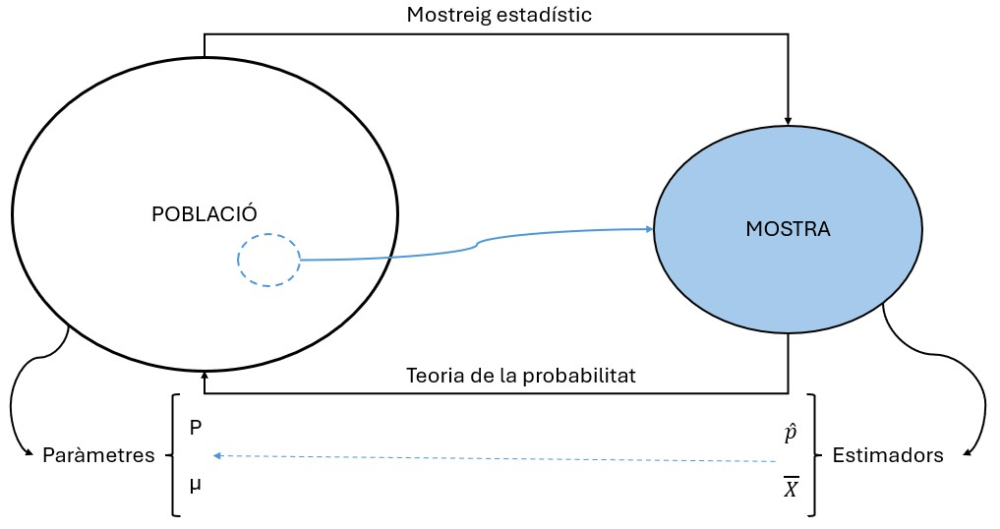
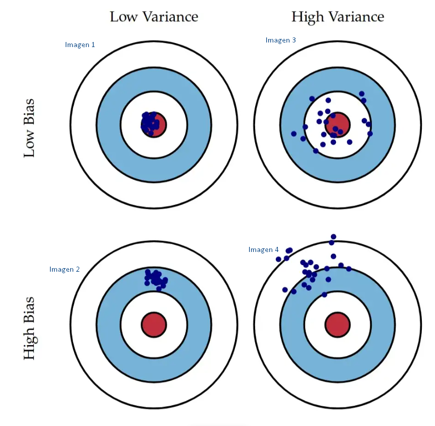

```{r}
#| label: setup
#| include: false
library(tidyverse)
options(width = 70, pillar.width = 70)
set.seed(123)

# Colors del tema (una sola tonalitat: bordeus)
bordeus      <- "#6D071A"
bordeus_clar <- "#D8A9B1"
gris_fosc    <- "#2B2B2B"

theme_set(
  theme_minimal(base_size = 20) +
    theme(panel.grid.minor = element_blank(),
          strip.text = element_text(size = 18, face = "bold", hjust = 0),
          plot.title.position = "plot")
)

# Números amb coma decimal per al text de les slides
num <- function(x, d = 1) format(round(x, d), nsmall = d, decimal.mark = ",", big.mark = ".")

competencies <- read_csv2("dades/competencies.csv", show_col_types = FALSE) |>
  mutate(habitat = factor(habitat,
                          levels = c("Fins a 10000", "De 10001 a 100000", "Més de 100000")))
n <- nrow(competencies)
```

# Benvinguda {.seccio background-color="#6D071A"}

::: notes
**9:30 – 9:35 (5')** Pla del dia. El recordatori de projectes i directori de treball és al final de la descriptiva, just abans de la pràctica.
:::

## Què farem avui?

| Hora | Què farem |
|:---:|---|
| 9.30 | **Estadística descriptiva**: una mica de teoria, molt ràpida |
| 10.05 | **Pràctica**: acabar la pràctica 1 i afegir-hi descriptiva amb `summarise()` |
| 11.00 | *Pausa* |
| 11.30 | **Inferència**: les idees bàsiques |
| 12.15 | **Pràctica 2**: quatre coses d'inferència amb les mateixes dades |

: {tbl-colwidths="[15,85]"}

::: {.petit .gris}
A les slides trobareu enllaços 📖 **Per aprofundir**: documents opcionals, pensats per llegir pel vostre compte.
:::

# Estadística descriptiva {.seccio background-color="#6D071A"}

::: notes
**9:35 – 10:00 (25')** Teoria ràpida, sense exercicis: ja els faran a la pràctica (part A de la pràctica 2). Res de fórmules, excepte la desviació típica a mà (perquè vegin que no és màgia). **10:00 – 10:05** Recordatori de R (últimes 3 slides de la secció) abans de la pràctica.
:::

## Què és l'estadística descriptiva?

- **Resumir** moltes dades amb pocs números (i algun gràfic)
- És el **primer pas** de qualsevol anàlisi: abans de treure conclusions, cal saber què tenim
- Què podem calcular depèn del **tipus de variable**:

| Tipus de variable | Què calculem | Amb R |
|---|---|---|
| **Categòrica** (nominal) | Freqüències i percentatges, moda | `count()` |
| **Categòrica ordinal** | El mateix + percentatges **acumulats** | `count()` + `cumsum()` |
| **Quantitativa** | Mitjana, mediana, quartils, desviació típica... | `summarise()` |

## Variables categòriques: `count()`

Quants alumnes hi ha a cada categoria? (**freqüència absoluta**)

```{r}
competencies |>
  count(titularitat)
```

. . .

I quin **percentatge** representen? Ho afegim amb `mutate()`:

```{r}
competencies |>
  count(titularitat) |>
  mutate(percentatge = n / sum(n) * 100)
```

## Variables ordinals: percentatge acumulat

Si les categories tenen un **ordre**, podem anar sumant els percentatges amb `cumsum()`:

```{r}
competencies |>
  count(habitat) |>
  mutate(percentatge = n / sum(n) * 100,
         percentatge_acumulat = cumsum(percentatge))
```

<br>

::: {.caixa}
**Com es llegeix?** El `r num(mean(competencies$habitat != "Més de 100000") * 100, 0)` % dels alumnes estudien en municipis de 100.000 habitants o menys. Només té sentit perquè `habitat` és un **factor ordenat**.
:::

## Variables numèriques: quines mesures fem servir?

| Pregunta | Mesura | Amb R |
|---|---|---|
| On és el **centre**? | Mitjana, mediana | `mean()`, `median()` |
| Com es **reparteixen** els valors? | Quartils, percentils | `quantile()` |
| Com d'**escampats** estan? | Desviació típica, interval interquartílic (IQR), rang | `sd()`, `IQR()`, `min()`, `max()` |

: {tbl-colwidths="[30,40,30]"}

<br>

::: {.missatge}
No cal memoritzar fórmules: cal saber **què vol dir** cada número.
:::

## Mitjana i mediana

:::: {.columns}

::: {.column width="50%"}
### Mitjana
- Sumem tots els valors i dividim pel nombre de valors
- **Sensible** als valors extrems
:::

::: {.column width="50%"}
### Mediana
- El valor **del mig** quan ordenem les dades
- **No es veu afectada** pels extrems
:::

::::

::: {.caixa-verda}
**Exemple**: alçades de 5 persones (cm): 165, 168, 170, 172 i **210**
:::

:::: {.columns}

::: {.column width="50%"}
```{r}
alcades <- c(165, 168, 170, 172, 210)
mean(alcades)
```
:::

::: {.column width="50%"}
```{r}
median(alcades)
```
:::

::::

::: {.petit .gris}
Una sola persona molt alta «estira» la mitjana cap amunt. La mediana no es mou.
:::

## Mitjana o mediana? Ens diuen com és la distribució

```{r}
#| echo: false
#| fig-width: 11
#| fig-height: 4
mitjana_ang <- mean(competencies$nota_ang, na.rm = TRUE)
mediana_ang <- median(competencies$nota_ang, na.rm = TRUE)

ggplot(competencies, aes(x = nota_ang)) +
  geom_histogram(binwidth = 5, boundary = 0, fill = bordeus_clar, color = "white") +
  geom_vline(xintercept = mitjana_ang, color = bordeus, linetype = "dashed", linewidth = 1) +
  geom_vline(xintercept = mediana_ang, color = gris_fosc, linetype = "dotted", linewidth = 1) +
  annotate("text", x = mitjana_ang - 1, y = Inf, vjust = 1.5, hjust = 1, color = bordeus,
           label = paste("Mitjana:", num(mitjana_ang)), size = 5) +
  annotate("text", x = mediana_ang + 1, y = Inf, vjust = 1.5, hjust = 0, color = gris_fosc,
           label = paste("Mediana:", num(mediana_ang)), size = 5) +
  labs(x = "Puntuació d'anglès (0-100)", y = "Nombre d'alumnes")
```

::: {.petit}
- **Mitjana < mediana**: hi ha una **cua a l'esquerra** (alguns alumnes amb notes molt baixes). És el cas de les notes d'anglès
- **Mitjana > mediana**: cua a la **dreta** (uns quants valors molt alts). És el cas típic dels **sous**
:::

::: {.petit .gris}
📖 **Per aprofundir**: la forma d'una distribució es pot mesurar amb l'**asimetria** i la **curtosi**. Ho trobareu a les [slides de descriptiva de la sessió 1](../../sessio-1/slides/descriptiva.html){target="_blank"}.
:::

## Quartils: tallar les dades ordenades en quatre trossos {.nostretch}

La mediana parteix les dades ordenades **en dues meitats**; els **quartils**, **en quatre quarts** (un 25 % a cada quart). Exemple amb 12 notes sobre 10, **ordenades**: 4 quarts de 3 notes.

```{r}
#| echo: false
#| fig-width: 11
#| fig-height: 1.7
#| out-width: "90%"
notes_joguina <- tibble(posicio = 1:12, nota = c(2, 3, 4, 4, 5, 6, 6, 7, 8, 8, 9, 10)) |>
  mutate(quart = factor((posicio - 1) %/% 3 %% 2))
marques <- tibble(posicio = c(3.5, 6.5, 9.5), etiqueta = c("Q1 = 4", "Mediana = 6", "Q3 = 8"))

ggplot(notes_joguina, aes(x = posicio, y = 1)) +
  geom_tile(aes(fill = quart), width = 0.9, height = 0.8, color = "white") +
  geom_text(aes(label = nota), size = 8, fontface = "bold", color = gris_fosc) +
  geom_vline(xintercept = c(3.5, 6.5, 9.5), linetype = "dashed", color = bordeus, linewidth = 1) +
  geom_label(data = marques, aes(label = etiqueta), y = 0.3, size = 5.5, color = bordeus,
             label.size = 0, fill = "white") +
  scale_fill_manual(values = c("0" = bordeus_clar, "1" = "#EBD3D7"), guide = "none") +
  coord_cartesian(ylim = c(0.15, 1.4)) +
  theme_void()
```

:::: {.columns}

::: {.column width="45%"}
```{r}
notes <- c(2, 3, 4, 4, 5, 6,
           6, 7, 8, 8, 9, 10)
quantile(notes)
```
:::

::: {.column width="55%"}
::: {.petit}
- **$Q_1$ = 4**: entre la 3a i la 4a nota. Per sota, el quart **més baix** (2, 3 i 4)
- **$Q_2$ = 6**: la **mediana**, entre la 6a i la 7a nota
- **$Q_3$ = 8**: entre la 9a i la 10a. Per sobre, el quart **més alt** (8, 9 i 10)
- `0%` i `100%`: el **mínim** i el **màxim**
:::
:::

::::

## Quartils amb les dades reals

```{r}
#| echo: false
#| fig-width: 11
#| fig-height: 3
quartils_cat <- quantile(competencies$nota_cat, c(0.25, 0.5, 0.75), na.rm = TRUE)

ggplot(competencies, aes(x = nota_cat)) +
  geom_histogram(binwidth = 5, boundary = 0, fill = bordeus_clar, color = "white") +
  geom_vline(xintercept = quartils_cat, color = bordeus, linetype = "dashed", linewidth = 1) +
  annotate("text", x = quartils_cat, y = Inf, vjust = 1.4, hjust = 1.05, color = bordeus, size = 5,
           label = c("Q1", "Mediana", "Q3")) +
  annotate("text", x = c(45, 71.5, 81.7, 93), y = 35, size = 5.5, color = gris_fosc,
           label = "25 %") +
  labs(x = "Puntuació de català (0-100)", y = "Nombre d'alumnes")
```

```{r}
quantile(competencies$nota_cat, na.rm = TRUE)
```

::: {.petit}
Un 25 % dels alumnes treu menys de **`r num(quartils_cat[1])`** punts, la meitat menys de **`r num(quartils_cat[2])`**, i un 25 % més de **`r num(quartils_cat[3])`**. Entre $Q_1$ i $Q_3$ hi ha **el 50 % central** dels alumnes.
:::

## Percentils: el mateix, però en 100 trossos

::: {.petit}
- El **percentil $p$** és el valor que deixa **per sota el $p$ %** de les observacions
- Els quartils són percentils concrets: $Q_1$ = percentil 25, mediana = percentil 50, $Q_3$ = percentil 75
- Un exemple conegut: les **corbes de creixement** del pediatre. «El nen és al percentil 80 d'alçada» vol dir que és més alt que el 80 % dels nens de la seva edat
:::

Amb R, triem quins percentils volem amb `probs` (en tant per u):

```{r}
quantile(competencies$nota_cat, probs = c(0.10, 0.90), na.rm = TRUE)
```

::: {.caixa}
**Com es llegeix?** El 10 % dels alumnes amb notes més baixes en català treu menys de `r num(quantile(competencies$nota_cat, 0.1, na.rm = TRUE))` punts (percentil 10), i el 10 % amb notes més altes, més de `r num(quantile(competencies$nota_cat, 0.9, na.rm = TRUE))` (percentil 90).
:::

## Dispersió: com d'escampats estan els valors?

```{r}
#| echo: false
#| fig-width: 11
#| fig-height: 3.6
set.seed(123)
dades_sd <- bind_rows(
  tibble(valor = rnorm(10000, mean = 70, sd = 5),  grup = "Desviació típica = 5"),
  tibble(valor = rnorm(10000, mean = 70, sd = 10), grup = "Desviació típica = 10"),
  tibble(valor = rnorm(10000, mean = 70, sd = 20), grup = "Desviació típica = 20")
) |>
  mutate(grup = factor(grup, levels = unique(grup)))

ggplot(dades_sd, aes(x = valor)) +
  geom_histogram(aes(y = after_stat(density)), bins = 60, fill = bordeus_clar, color = "white") +
  geom_vline(xintercept = 70, color = bordeus, linetype = "dashed", linewidth = 1) +
  facet_wrap(~ grup, ncol = 3) +
  coord_cartesian(xlim = c(10, 130)) +
  labs(x = NULL, y = NULL) +
  theme(axis.text.y = element_blank())
```

::: {.petit}
Tres grups amb la **mateixa mitjana** (70) i dispersió molt diferent. La mitjana sola no ho explica tot!

- **Desviació típica** (`sd()`): la distància «típica» dels valors respecte de la mitjana. Petita → valors agrupats; gran → valors escampats
- **Interval interquartílic** (`IQR()`): $Q_3 - Q_1$, l'amplada del 50 % central. No es veu afectat pels extrems
:::

## Com es calcula la desviació típica? No és màgia

:::: {.columns}

::: {.column width="52%"}
::: {.petit}
Alçades de **5 persones** (cm): 160, 170, 180, 165 i 175

| Alçada $x_i$ | Diferència amb la mitjana $x_i - \bar{x}$ | Al quadrat $(x_i - \bar{x})^2$ |
|:---:|:---:|:---:|
| 160 | −10 | 100 |
| 170 | 0 | 0 |
| 180 | +10 | 100 |
| 165 | −5 | 25 |
| 175 | +5 | 25 |
| **Suma** | **0** | **250** |

: {tbl-colwidths="[24,40,36]"}
:::

```{r}
alcades2 <- c(160, 170, 180, 165, 175)
var(alcades2)   # variància
sd(alcades2)    # desviació típica
```
:::

::: {.column width="48%"}
::: {.petit}
1. **Mitjana**: $\bar{x} = 850 / 5 = 170$
2. **Diferència** de cada persona amb la mitjana. Sumen 0: per això les elevem **al quadrat**
3. **Variància**: la «mitjana» dels quadrats
$$s^2 = \frac{\sum (x_i - \bar{x})^2}{n - 1} = \frac{250}{4} = 62{,}5$$
4. **Desviació típica**: l'arrel quadrada, per tornar a les unitats originals (cm)
$$s = \sqrt{62{,}5} \approx 7{,}9 \text{ cm}$$
:::
:::

::::

::: {.petit .gris}
Dividim per $n - 1$ (i no per $n$) perquè treballem amb una **mostra**: és el que fa R per defecte.
:::

## Compte amb els valors perduts: `na.rm = TRUE`

`r sum(is.na(competencies$nota_cat))` alumnes **no tenen nota de català** (`NA`). Si en demanem la mitjana:

```{r}
mean(competencies$nota_cat)
```

. . .

R no pot sumar un valor desconegut i ens torna `NA`. Li hem de dir que **ignori els `NA`**:

```{r}
mean(competencies$nota_cat, na.rm = TRUE)
```

. . .

::: {.caixa}
`na.rm = TRUE` vol dir «treu els `NA`» (*NA remove*). Funciona igual a `median()`, `sd()`, `quantile()`, `IQR()`, `min()` i `max()`.

Quants n'hi ha? `sum(is.na(competencies$nota_cat))`
:::

## Tot de cop: `summary()` i `summarise()`

```{r}
summary(competencies$nota_cat)
```

. . .

O a la nostra manera, triant què volem calcular:

```{r}
competencies |>
  summarise(mitjana     = mean(nota_cat, na.rm = TRUE),
            mediana     = median(nota_cat, na.rm = TRUE),
            q1          = quantile(nota_cat, 0.25, na.rm = TRUE),
            q3          = quantile(nota_cat, 0.75, na.rm = TRUE),
            desv_tipica = sd(nota_cat, na.rm = TRUE))
```

::: {.petit .gris}
`summarise()` **resumeix moltes files en una sola**. Cada línia: `nom_que_vull = funcio(variable)`. A la sessió 3 hi afegirem `group_by()` per fer-ho **per grups**.
:::

## El diagrama de caixa (*boxplot*)

:::: {.columns}

::: {.column width="45%"}
Els **quartils** en un gràfic:

- La **caixa** va de $Q_1$ a $Q_3$: hi ha el 50 % central dels alumnes
- La **línia** del mig és la **mediana**
- Els **bigotis** arriben als valors «normals»
- Els **punts** són valors atípics (*outliers*)
:::

::: {.column width="55%"}
```{r}
#| echo: false
#| fig-width: 6.5
#| fig-height: 4.4
q <- quantile(competencies$nota_cat, c(0.25, 0.5, 0.75), na.rm = TRUE)

ggplot(competencies, aes(x = 0, y = nota_cat)) +
  geom_boxplot(fill = bordeus_clar, width = 0.5, outlier.size = 2.5) +
  annotate("text", x = 0.3, y = q, label = c("Q1", "Mediana", "Q3"), hjust = 0, size = 5) +
  annotate("text", x = 0.12, y = 25, label = "Outliers", hjust = 0, size = 5) +
  coord_cartesian(xlim = c(-0.5, 0.8)) +
  labs(x = NULL, y = "Puntuació de català") +
  theme(axis.text.x = element_blank(), panel.grid.major.x = element_blank())
```
:::

::::

::: {.petit .gris}
📖 **Per aprofundir**: per fer aquest gràfic i d'altres amb R, vegeu el [tutorial de `ggplot2`](../explicacions/tutorial_ggplot2.html){target="_blank"}.
:::

## Abans de la pràctica: on treballa R?

- R sempre treballa des d'una carpeta: el **directori de treball**
- `getwd()` (*get working directory*) ens diu quina és:

```{r}
#| eval: false
getwd()
#> "C:/Users/.../sessio-1"      ← ha d'acabar amb la carpeta del projecte
```

- Si obrim un **projecte** (`.Rproj`), el directori de treball és **la carpeta del projecte**
- Per això les rutes són curtes: `"dades/competencies_basiques.csv"` vol dir «la carpeta `dades` de dins del projecte»

::: {.caixa .petit}
**Error típic**: `'dades/...csv' does not exist in current working directory` vol dir que R no és a la carpeta del projecte. **Solució**: tanqueu RStudio i obriu el fitxer `.Rproj`.
:::

## I `setwd()`?

`setwd()` (*set working directory*) canvia el directori de treball. **No el farem servir**:

:::: {.columns}

::: {.column width="50%"}
### ❌ Amb `setwd()`

```{r}
#| eval: false
setwd("C:/Users/anna/Documents/curs/sessio-1")
```

- Només funciona en **aquest** ordinador
- Si moveu o reanomeneu la carpeta, **falla**
:::

::: {.column width="50%"}
### ✅ Amb un projecte

Doble clic a `sessio_1.Rproj`

- R ja és a la carpeta correcta
- Funciona a **qualsevol** ordinador
- No cal escriure cap ruta llarga
:::

::::

## Pas a pas: obrir els materials d'una sessió

1. Descarregueu el **zip** de la web del curs
2. **Descomprimiu-lo**: botó dret → *Extreu-ho tot*. No treballeu des de dins del zip!
3. Entreu a la carpeta descomprimida i feu **doble clic** a `sessio_N.Rproj`
4. Comproveu que a dalt a la dreta de RStudio hi diu **`sessio_N`**
5. Al panell *Files* (a baix a la dreta), obriu la carpeta `codi/` i l'script
6. Executeu `getwd()`: ha d'acabar en **`sessio-N`**

::: {.caixa-verda}
**Ara**: descarregueu i descomprimiu el zip de la **sessió 2**. Qui hagi d'acabar la pràctica 1, obriu el projecte de la **sessió 1** i el vostre `codi/exercici_sessio_1.R`.
:::

# Pràctica: acabem la 1 i comencem la 2 {.seccio background-color="#6D071A"}

::: notes
**10:05 – 11:00 (55')** Pràctica en tres nivells. Passar per les taules i dedicar el temps a qui va més perdut; qui vagi avançat, al tutorial de ggplot2. **10:50** Si hi ha temps, ensenyar ràpidament la correcció dels passos 1–10 (slides següents). La solució de la part A és a `codi/solucio_exercici_sessio_2.R` (es publica després de la sessió).
:::

## Pràctica: cadascú al seu ritme

:::: {.columns}

::: {.column width="33%"}
::: {.caixa}
**1. Acabar la pràctica 1**

Els **passos 1 a 10** (importar, netejar i exportar), al projecte de la **sessió 1**
:::
:::

::: {.column width="33%"}
::: {.caixa}
**2. Pràctica 2, part A**

**Descriptiva** amb `count()` i `summarise()`, al projecte de la **sessió 2**
:::
:::

::: {.column width="33%"}
::: {.caixa-verda}
**3. Ja ho teniu?**

El [tutorial de `ggplot2`](../explicacions/tutorial_ggplot2.html){target="_blank"}: els vostres primers gràfics
:::
:::

::::

::: {.petit}
- La part A es fa amb les dades **ja netes** de la sessió 2: no cal haver acabat la pràctica 1 per començar-la
- Lliurament: per una banda, la pràctica 1 (script i CSV); per l'altra, la pràctica 2 (parts A i B en un sol script)
:::

::: {.caixa-verda .petit}
**No vau arribar al pas 4 de la pràctica 1?** A la web de la sessió 2 teniu `exercici_sessio_1_passos_1-4.R`, amb els passos 1 a 4 ja fets. Deseu-lo a la carpeta `sessio-1/codi/`, obriu-lo des del panell *Files* i continueu des del pas 5.
:::

## On érem? Passos 1 a 10

::: {.petit}
:::: {.columns}

::: {.column width="50%"}
1. Carregar el `tidyverse` i **importar** amb `read_csv2()`
2. **Mirar** les dades amb `glimpse()`
3. `select()`: quedar-se amb `CODI_ALUMNE`, `GENERE`, `NATURALESA`, `HABITAT`, `PCAT`, `PMAT` i `PANG`
4. `rename()`: noms clars en minúscules (`id`, `genere`, `titularitat`, `habitat`, `nota_cat`...)
5. `mutate()` + `case_when()`: `D` → `"Dona"`, `H` → `"Home"`
:::

::: {.column width="50%"}
6. `mutate()` + `factor()`: ordenar `habitat` de menys a més habitants
7. `mutate()`: crear `nota_mitjana` i `nivell_mat` (Baix < 50, Mitjà 50–75, Alt ≥ 75)
8. `filter()`: eliminar els alumnes sense nota de matemàtiques
9. Un **comentari** amb una limitació de les dades
10. **Exportar** amb `write_csv2()` a `dades/competencies_basiques_net.csv`
:::

::::
:::

::: {.caixa-verda}
Feu-la **pas a pas**: escriviu una línia, executeu-la (Ctrl + Enter) i comproveu el resultat amb `glimpse()` abans de seguir.
:::

## Pràctica 2 · Part A: descriptiva

Projecte de la **sessió 2** (`sessio_2.Rproj`), plantilla `codi/exercici_sessio_2.R` i dades `dades/competencies.csv`, ja netes: són exactament les que surten de la pràctica 1.

::: {.petit}
**Pas 1. Importar les dades** amb `read_csv2()` i tornar a ordenar `habitat` amb `factor()` (el CSV no guarda l'ordre).

**Pas 2. Freqüències de `habitat`**: absolutes, percentatges i acumulats. *Pista*: `count()` i `mutate()` amb `n / sum(n) * 100` i `cumsum()`. Quin percentatge estudia en municipis de 100.000 habitants o menys?

**Pas 3. Descriptiva de `nota_cat`** amb `summarise()`: mitjana, mediana, $Q_1$, $Q_3$, desviació típica i IQR. *Pista*: `na.rm = TRUE`. La mitjana és més alta o més baixa que la mediana? Què vol dir?

**Pas 4. Comparar les tres assignatures**: en un sol `summarise()`, la mitjana i la mediana de `nota_cat`, `nota_mat` i `nota_ang`. En quina s'obtenen les notes més altes?
:::

::: {.caixa .petit}
Escriviu les respostes **en paraules**, amb comentaris (`#`). Les slides de descriptiva i `codi/01_descriptiva_inferencia.R` us fan de xuleta.
:::

## Quan alguna cosa falla

R ens avisa a la **consola**. Els errors més habituals:

| Missatge | Què vol dir |
|---|---|
| `could not find function "read_csv2"` | No heu carregat el paquet: `library(tidyverse)` |
| `object 'competencies' not found` | No heu executat la línia que crea l'objecte, o el nom està mal escrit |
| `'dades/...' does not exist` | R no és a la carpeta del projecte (obriu el `.Rproj`) |
| `unexpected symbol` | Falta una coma, un parèntesi o un `|>` |
| La consola mostra `+` i no passa res | Falta tancar un parèntesi o unes cometes: premeu **Esc** |
| El resultat és `NA` | Hi ha valors perduts: afegiu `na.rm = TRUE` |

: {tbl-colwidths="[45,55]"}

## El teu torn (55') {.el-teu-torn}

1. **Acabeu** la pràctica 1: passos 1 a 10 (projecte de la sessió 1)
2. **Pràctica 2, part A**: descriptiva, passos 1 a 4 (projecte de la sessió 2)
3. **Ja ho teniu tot?** Seguiu el [tutorial de `ggplot2`](../explicacions/tutorial_ggplot2.html){target="_blank"}

<br>

::: {.caixa-verda .petit}
**Lliurament** per **correu electrònic** a [joelardiacaarnau@gencat.cat](mailto:joelardiacaarnau@gencat.cat):

- Pràctica 1: `exercici_sessio_1.R` (passos 1 a 10) i `competencies_basiques_net.csv`
- Pràctica 2: `exercici_sessio_2.R` (part A ara i part B després de la pausa)
:::

::: {.petit .gris}
Mentre treballeu aniré passant per les taules. Si us encalleu, aviseu!
:::

## Correcció · Passos 1 a 4

::: {.petit}
```{r}
#| eval: false
library(tidyverse)

# Pas 1: importar (CSV amb ; i coma decimal -> read_csv2)
competencies <- read_csv2("dades/competencies_basiques.csv")

# Pas 2: mirar les dades
glimpse(competencies)   # 500 files i 9 columnes

# Passos 3 i 4: seleccionar i reanomenar
competencies_net <- competencies |>
  select(CODI_ALUMNE, GENERE, NATURALESA, HABITAT, PCAT, PMAT, PANG) |>
  rename(id = CODI_ALUMNE, genere = GENERE, titularitat = NATURALESA,
         habitat = HABITAT, nota_cat = PCAT, nota_mat = PMAT, nota_ang = PANG)
```
:::

::: {.petit .gris}
`CODI_ALUMNE` és numèric, però no és una variable quantitativa: és un **identificador** (no té sentit fer-ne la mitjana).
:::

## Correcció · Passos 5 a 10

::: {.petit}
```{r}
#| eval: false
competencies_net <- competencies_net |>
  mutate(
    genere = case_when(genere == "D" ~ "Dona",                       # Pas 5
                       genere == "H" ~ "Home"),
    habitat = factor(habitat, levels = c("Fins a 10000",               # Pas 6
                                         "De 10001 a 100000",
                                         "Més de 100000")),
    nota_mitjana = (nota_cat + nota_mat + nota_ang) / 3,               # Pas 7
    nivell_mat = case_when(nota_mat < 50  ~ "Baix",
                           nota_mat < 75  ~ "Mitjà",
                           nota_mat >= 75 ~ "Alt")
  ) |>
  filter(!is.na(nota_mat))                                             # Pas 8

glimpse(competencies_net)   # queden 480 alumnes

write_csv2(competencies_net, "dades/competencies_basiques_net.csv")   # Pas 10
```
:::

::: {.petit .gris}
Pas 9 (limitació): els alumnes sense nota potser no falten a l'atzar; és una mostra (hi haurà marge d'error); una prova d'un dia no ho mesura tot...
:::

# Pausa ☕ {.seccio background-color="#6D071A"}

::: notes
**11:00 – 11:30** Pausa.
:::

# Inferència {.seccio background-color="#6D071A"}

::: notes
**11:30 – 12:15 (45')** Idees clau i comandes, poca fórmula. Primer la introducció teòrica (sense ordinador); quan arribem al codi, canvien al projecte de la sessió 2 i segueixen la secció 3 de `codi/01_descriptiva_inferencia.R`. Les justificacions són als documents 📖 (opcionals).
:::

## De la mostra a la població

- Tenim **`r n` alumnes**, però volem parlar dels **73.431** alumnes de 6è de Catalunya
- La **inferència estadística** ens permet fer-ho... amb un **marge d'error**
- Com que treballem amb una **mostra**, sempre hi haurà **incertesa**. La bona notícia: la podem **quantificar**

::: {.caixa-verda}
**Exemple**: una enquesta del CEO a 2.000 persones per conèixer l'opinió de tota la població de Catalunya.
:::

## El procés d'inferència estadística

{fig-align="center" height="540"}

## Una mostra gran pot fallar: Landon vs. Roosevelt (1936)

:::: {.columns}

::: {.column width="55%"}
- El *Literary Digest* va enviar **10 milions** de qüestionaris i va rebre **2,3 milions** de respostes
- Va predir una àmplia victòria del republicà Alf Landon
- George Gallup va enquestar **50.000** persones triades a l'atzar
- Va guanyar **Franklin D. Roosevelt** amb el 61 % del vot
:::

::: {.column width="45%"}
::: {.caixa}
**Què va fallar?**

La mostra sortia de llistes de telèfons i de subscriptors: una població **més rica i més conservadora**. No era una mostra **aleatòria**.
:::
:::

::::

## Biaix i precisió

:::: {.columns}

::: {.column width="50%"}
- Una mostra **no aleatòria** té **biaix**: apunta al lloc equivocat, per gran que sigui
- La **mida** de la mostra determina la **precisió**: com més gran, menys variació
- Necessitem totes dues coses: **aleatorietat** i **mida**

::: {.missatge}
La qualitat de la mostra importa més que la mida.
:::
:::

::: {.column width="50%"}
{height="500"}
:::

::::

## Cada mostra dona un resultat diferent

```{r}
#| echo: false
#| fig-width: 11
#| fig-height: 3.1
set.seed(2026)
poblacio <- pmin(pmax(rnorm(73431, mean = 73.55, sd = 17.5), 0), 100)
mitjanes <- tibble(mitjana = replicate(1000, mean(sample(poblacio, 480))))

ggplot(mitjanes, aes(x = mitjana)) +
  geom_histogram(binwidth = 0.25, fill = bordeus_clar, color = "white") +
  geom_vline(xintercept = mean(poblacio), color = bordeus, linetype = "dashed", linewidth = 1) +
  annotate("text", x = mean(poblacio) + 0.15, y = Inf, vjust = 1.5, hjust = 0, color = bordeus,
           label = "Mitjana real", size = 5) +
  labs(x = "Nota mitjana de matemàtiques de cada mostra de 480 alumnes",
       y = "Nombre de mostres")
```

::: {.petit}
Si poguéssim repetir la mostra **1.000 vegades**, cada cop obtindríem una mitjana una mica diferent, però gairebé sempre a prop de la real. La variació d'aquestes mitjanes és l'**error estàndard**. I tenen forma de campana (**distribució normal**): per això funcionen els càlculs que farem.
:::

::: {.petit .gris}
📖 **Per aprofundir**: [Per què cada mostra dona un resultat diferent](../explicacions/02_distribucio_mostreig_alcada.html){target="_blank"} · [I si la població no és normal?](../explicacions/03_distribucio_mostreig_renda.html){target="_blank"}
:::

## Canviem de projecte

:::: {.columns}

::: {.column width="55%"}
Ara passem a R. Tothom treballa ja amb el projecte de la **sessió 2**.

`dades/competencies.csv` és **el mateix fitxer** que s'exporta al pas 10 de la pràctica 1: 480 alumnes de 6è, amb les variables ja netes.
:::

::: {.column width="45%"}
::: {.caixa-verda .petit}
**Ara**: si encara sou al projecte de la sessió 1, tanqueu-lo. Obriu `sessio_2.Rproj` i després `codi/01_descriptiva_inferencia.R` (secció 3).
:::
:::

::::

```{r}
#| eval: false
library(tidyverse)
competencies <- read_csv2("dades/competencies.csv")
```

## L'error estàndard

Mesura **quant pot variar la nostra estimació** pel fet de treballar amb una mostra:

$$SE = \frac{\text{desviació típica}}{\sqrt{n}}$$

```{r}
competencies |>
  summarise(mitjana     = mean(nota_mat),
            desv_tipica = sd(nota_mat),
            n           = n(),
            se          = desv_tipica / sqrt(n))
```

::: {.petit}
- Com **més gran** és la mostra ($n$), **més petit** és l'error estàndard: més precisió
- Dins de `summarise()` podem fer servir les columnes que acabem de crear (`desv_tipica`, `n`)
:::

## La regla del 95 %

:::: {.columns}

::: {.column width="45%"}
- En una distribució **normal**, el **95 %** dels valors queden a menys de **1,96 desviacions típiques** del centre
- Aplicat a les mostres: en el 95 % dels casos, la mitjana de la mostra queda a menys de **1,96 errors estàndard** de la mitjana real
:::

::: {.column width="55%"}
```{r}
#| echo: false
#| fig-width: 7
#| fig-height: 4.4
corba <- tibble(z = seq(-3.5, 3.5, length.out = 500), densitat = dnorm(z))

ggplot(corba, aes(x = z, y = densitat)) +
  geom_area(data = filter(corba, abs(z) <= 1.96), fill = bordeus_clar, alpha = 0.8) +
  geom_line(color = bordeus, linewidth = 1) +
  annotate("text", x = 0, y = 0.15, label = "95 %", color = bordeus, size = 9, fontface = "bold") +
  annotate("text", x = c(-2.7, 2.7), y = 0.04, label = "2,5 %", size = 5) +
  scale_x_continuous(breaks = c(-1.96, 0, 1.96),
                     labels = c("−1,96 SE", "Mitjana\nreal", "+1,96 SE")) +
  labs(x = NULL, y = NULL) +
  theme(axis.text.y = element_blank(), panel.grid = element_blank())
```
:::

::::

::: {.petit .gris}
📖 **Per aprofundir**: [La distribució normal i el valor z: d'on surt l'1,96](../explicacions/01_normal_valor_z.html){target="_blank"}
:::

## Interval de confiança del 95 %

Un rang de valors on, amb un 95 % de confiança, hi ha el valor real de la població: $\text{mitjana} \pm 1{,}96 \cdot SE$

```{r}
competencies |>
  summarise(mitjana = mean(nota_mat),
            se      = sd(nota_mat) / sqrt(n()),
            inf     = mitjana - 1.96 * se,
            sup     = mitjana + 1.96 * se)
```

```{r}
#| include: false
se_mat <- sd(competencies$nota_mat) / sqrt(n)
ic_mat <- mean(competencies$nota_mat) + c(-1.96, 1.96) * se_mat
```

::: {.caixa}
**Com es llegeix?** Amb un 95 % de confiança, la nota mitjana de matemàtiques de **tots** els alumnes de 6è de Catalunya és entre `r num(ic_mat[1])` i `r num(ic_mat[2])` punts.
:::

## Amb una sola comanda: `t.test()`

```{r}
t.test(competencies$nota_mat)$conf.int
```

<br>

- Dona (pràcticament) el **mateix interval** que el nostre càlcul
- Fa servir la distribució *t* de Student en lloc de l'1,96: amb mostres grans, la diferència és mínima
- `$conf.int` vol dir «d'aquest resultat, dona'm només l'interval»
- **Ignora els `NA` automàticament**

::: {.petit .gris}
📖 **Per aprofundir**: [Què fa per dins `t.test()`?](../explicacions/04_introduccio_ttest.html){target="_blank"}
:::

## Què vol dir «95 % de confiança»?

```{r}
#| echo: false
#| fig-width: 12
#| fig-height: 3.7
set.seed(2026)
mu <- 73.5
intervals <- map_dfr(1:50, \(i) {
  x  <- rnorm(100, mean = mu, sd = 17)
  ic <- t.test(x)$conf.int
  tibble(mostra = i, inf = ic[1], sup = ic[2], mitjana = mean(x))
}) |>
  mutate(conte = if_else(inf <= mu & sup >= mu, "Conté la mitjana real", "No la conté"))

ggplot(intervals, aes(x = mostra, ymin = inf, ymax = sup, color = conte)) +
  geom_hline(yintercept = mu, linetype = "dashed", color = gris_fosc) +
  geom_errorbar(width = 0, linewidth = 1) +
  geom_point(aes(y = mitjana), size = 1.8) +
  scale_color_manual(values = c("Conté la mitjana real" = bordeus_clar, "No la conté" = bordeus)) +
  labs(x = "Mostra", y = "IC del 95 %", color = NULL) +
  theme(legend.position = "top")
```

::: {.petit}
50 mostres, 50 intervals. Si repetíssim l'estudi moltes vegades, **el 95 % dels intervals contindrien la mitjana real**. El nostre és un d'aquests intervals: confiem que és dels «bons», però no ho podem saber del cert.
:::

::: {.petit .gris}
📖 **Per aprofundir**: [Què vol dir «95 % de confiança»? (simulació)](../explicacions/05_simulacio_intervals_confianca.html){target="_blank"}
:::

## Més confiança = interval més ample

```{r}
t.test(competencies$nota_mat, conf.level = 0.90)$conf.int
t.test(competencies$nota_mat, conf.level = 0.99)$conf.int
```

<br>

::: {.caixa}
Per estar **més segurs** d'encertar, hem d'acceptar un interval **més ample** (menys precís). El 95 % és el nivell més habitual.
:::

## Proporcions: el mateix raonament

Quin **percentatge** d'alumnes de Catalunya estudia en un centre **públic**? Primer, la proporció a la **mostra**, amb el que ja sabem fer:

```{r}
competencies |>
  count(titularitat) |>
  mutate(proporcio = n / sum(n))
```

```{r}
#| include: false
publics <- sum(competencies$titularitat == "Públic")
ic_publics <- prop.test(publics, n)$conf.int
```

::: {.caixa}
A la mostra, `r publics` dels `r n` alumnes (el `r num(publics / n * 100)` %) van a un centre públic. Però és una **mostra**: a tot Catalunya, el percentatge real serà una mica diferent. Quant? Ho diu l'**interval de confiança**.
:::

## Interval de confiança d'una proporció

:::: {.columns}

::: {.column width="45%"}
::: {.petit}
L'**error estàndard** d'una proporció $p$ té una fórmula pròpia:

$$SE = \sqrt{\frac{p\,(1 - p)}{n}}$$

Amb les nostres dades:

$$SE = \sqrt{\frac{0{,}66 \cdot 0{,}34}{480}} \approx 0{,}022$$

I l'interval, com sempre: $p \pm 1{,}96 \cdot SE$
:::
:::

::: {.column width="55%"}
A R, ho fa tot `prop.test(casos, total)`, amb els números de la taula anterior:

```{r}
prop.test(317, 480)$conf.int
```

::: {.caixa .petit}
**Com es llegeix?** Amb un 95 % de confiança, entre el `r num(ic_publics[1] * 100)` % i el `r num(ic_publics[2] * 100)` % dels alumnes de 6è de Catalunya van a un centre públic.
:::
:::

::::

::: {.petit .gris}
📖 **Per aprofundir**: [Proporcions i distribució binomial](../explicacions/06_binomial_aproximacio_normal.html){target="_blank"}
:::

## Mida de la mostra i marge d'error

```{r}
#| echo: false
#| fig-width: 11
#| fig-height: 3.3
tibble(n = seq(100, 5000, by = 10)) |>
  mutate(marge = 1.96 * sqrt(0.5 * 0.5 / n) * 100) |>
  ggplot(aes(x = n, y = marge)) +
  geom_line(color = bordeus, linewidth = 1.2) +
  scale_x_continuous(labels = scales::label_number(big.mark = ".")) +
  labs(x = "Mida de la mostra (n)",
       y = "Marge d'error (punts)")
```

::: {.petit .centre}
Marge d'error d'una enquesta (confiança del 95 %). Passar de 1.000 a 2.000 entrevistes **no** redueix el marge a la meitat: de ±3,1 a ±2,2 punts.
:::

::: {.petit .gris .centre}
📖 **Per aprofundir**: [d'on surt el marge d'error](../explicacions/06_binomial_aproximacio_normal.html#el-marge-derror-de-les-enquestes){target="_blank"}
:::

## Contrast d'hipòtesis: la idea

Una pregunta de **sí o no**: la nota mitjana de matemàtiques a Catalunya, **és diferent de 72**?

- **Hipòtesi nul·la** ($H_0$): la mitjana **és** 72 (no hi ha diferència)
- **Hipòtesi alternativa** ($H_1$): la mitjana **no és** 72
- El **p-valor**: com de sorprenents serien les nostres dades **si $H_0$ fos certa**

::: {.missatge}
Si el p-valor és **més petit que 0,05**, rebutgem $H_0$.
:::

::: {.petit .gris}
No demostrem res del cert: decidim si tenim **prou evidència** per rebutjar $H_0$. I el p-valor **no** és la probabilitat que $H_0$ sigui certa.
:::

## Contrast d'hipòtesis amb R

```{r}
t.test(competencies$nota_mat, mu = 72)
```

::: {.petit .gris}
📖 **Per aprofundir**: d'on surten el *t* i el p-valor, a [Què fa per dins `t.test()`?](../explicacions/04_introduccio_ttest.html){target="_blank"}
:::

## Llegir el resultat de `t.test()`

```{r}
#| include: false
contrast <- t.test(competencies$nota_mat, mu = 72)
```

| Resultat | Què vol dir |
|---|---|
| `p-value` | `r num(contrast$p.value, 3)`, menor que 0,05 → **rebutgem $H_0$** |
| `alternative hypothesis` | Què estem contrastant: la mitjana és diferent de 72 |
| `95 percent confidence interval` | L'interval de confiança que ja coneixem |
| `mean of x` | La mitjana de la mostra: `r num(mean(competencies$nota_mat))` |

: {tbl-colwidths="[40,60]"}

::: {.caixa}
**Conclusió**: les dades indiquen que la nota mitjana de matemàtiques **és diferent de 72** (més alta). Però per poc: el 72 queda **just fora** de l'interval de confiança (`r num(contrast$conf.int[1], 2)`–`r num(contrast$conf.int[2], 2)`).
:::

. . .

::: {.caixa-verda}
**En aquest cas coneixem la resposta**: la mitjana de **tots** els alumnes (73.431) és **73,55**. La mostra de 480 ens hi ha portat a prop.
:::

## Interval i contrast diuen el mateix

- Si el valor de $H_0$ queda **fora** de l'interval del 95 % → p < 0,05 → **rebutgem** $H_0$
- Si queda **dins** de l'interval → p > 0,05 → **no podem rebutjar** $H_0$

```{r}
t.test(competencies$nota_mat, mu = 74)$p.value
```

::: {.caixa}
El 74 és **dins** de l'interval (`r num(contrast$conf.int[1], 2)`–`r num(contrast$conf.int[2], 2)`): no tenim evidència que la mitjana sigui diferent de 74. Que no la puguem rebutjar **no vol dir** que la mitjana sigui exactament 74.
:::

## Resum: quina comanda per a què?

| Vull... | Comanda |
|---|---|
| Freqüències i percentatges | `count(variable) |> mutate(percentatge = n / sum(n) * 100)` |
| Mitjana, mediana, quartils, desviació... | `summarise(mitjana = mean(x, na.rm = TRUE), ...)` |
| Error estàndard | `summarise(se = sd(x) / sqrt(n()))` |
| Interval de confiança d'una mitjana | `t.test(dades$x)$conf.int` |
| Una proporció | `count(variable) |> mutate(proporcio = n / sum(n))` |
| Interval de confiança d'una proporció | `prop.test(casos, total)$conf.int` |
| Contrast d'una mitjana | `t.test(dades$x, mu = valor)` |

: {tbl-colwidths="[38,62]"}

# Pràctica 2 {.seccio background-color="#6D071A"}

::: notes
**12:15 – 13:20 (65')** Part B de `codi/exercici_sessio_2.R`. Qui no hagi fet la part A, que importi les dades (pas 1) i passi directament a la B. Passar per les taules. Qui acabi: temes d'ampliació (slide següent). Si no s'acaba, es pot acabar a casa. Solució: `codi/solucio_exercici_sessio_2.R`.
:::

## Pràctica 2 · Part B: quatre coses d'inferència

Al mateix `codi/exercici_sessio_2.R`, a continuació de la part A. Treballarem amb la **nota de català** (`nota_cat`):

5. **Interval de confiança del 95 %** de la nota mitjana: a mà amb `summarise()` i amb `t.test()`
6. Intervals del **90 %** i del **99 %**. Quin és més ample? Per què?
7. **Una proporció**: quin percentatge d'alumnes té nivell `"Alt"` de matemàtiques? Interval de confiança amb `prop.test()`
8. **Un contrast**: la nota mitjana de català, és diferent de 75?

::: {.caixa-verda .petit}
**Comenteu i interpreteu** cada resultat **en paraules** (amb `#` a l'script). Si no vau fer la part A, n'hi ha prou amb el pas 1 (importar les dades). Lliurament: l'script (parts A i B) per **correu electrònic** a [joelardiacaarnau@gencat.cat](mailto:joelardiacaarnau@gencat.cat).
:::

## Ja heu acabat? Temes d'ampliació

Documents per llegir pel vostre compte, amb simulacions i gràfics, i amb el codi R plegat:

::: {.petit}
:::: {.columns}

::: {.column width="50%"}
**Inferència**

1. [La distribució normal i el valor z](../explicacions/01_normal_valor_z.html){target="_blank"}
2. [Per què cada mostra dona un resultat diferent](../explicacions/02_distribucio_mostreig_alcada.html){target="_blank"}
3. [I si la població no és normal? El teorema del límit central](../explicacions/03_distribucio_mostreig_renda.html){target="_blank"}
4. [Què fa per dins `t.test()`?](../explicacions/04_introduccio_ttest.html){target="_blank"}
5. [Què vol dir «95 % de confiança»?](../explicacions/05_simulacio_intervals_confianca.html){target="_blank"}
6. [Proporcions i distribució binomial](../explicacions/06_binomial_aproximacio_normal.html){target="_blank"}
:::

::: {.column width="50%"}
**Descriptiva i gràfics**

- [Tutorial: primers gràfics amb `ggplot2`](../explicacions/tutorial_ggplot2.html){target="_blank"}
- [Slides de descriptiva de la sessió 1](../../sessio-1/slides/descriptiva.html){target="_blank"}: asimetria, curtosi i com fer bons gràfics
:::

::::
:::

::: {.caixa .petit}
Recomanació: llegiu-los **per ordre** (de l'1 al 6). Cada un acaba amb un resum de les idees clau.
:::

# Tancament {.seccio background-color="#6D071A"}

::: notes
**13:20 – 13:30 (10')** Resum i propera sessió. Recordar els lliuraments: pràctica 1 (passos 1–10) i pràctica 2 (parts A i B).
:::

## Què hem après avui?

:::: {.columns}

::: {.column width="50%"}
### Descriptiva
- Freqüències i percentatges: `count()`
- Mitjana, mediana, quartils, desviació típica i IQR: `summarise()`
- Els `NA` i `na.rm = TRUE`
- Mitjana vs. mediana: la forma de la distribució
:::

::: {.column width="50%"}
### Inferència
- Mostra i població: biaix i precisió
- Error estàndard
- Intervals de confiança: `t.test()`, `prop.test()`
- Contrast d'hipòtesis i p-valor
:::

::::

<br>

::: {.missatge}
Propera sessió (dl. 2 de novembre): **comparar grups**. Dones i homes, centres públics i privats... són diferents?
:::
