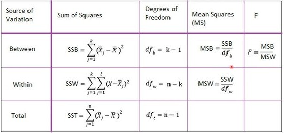

```{r setup, include=FALSE, warning=FALSE, message=FALSE}
set.seed(1234)
library(tidyverse)

bordeus      <- "#6D071A"
bordeus_clar <- "#D8A9B1"

# Números amb coma decimal per al text
num <- function(x, d = 1) format(round(unname(x), d), nsmall = d, decimal.mark = ",", big.mark = ".")
```

::: {.callout-note}
## Què hi trobareu?
A les slides hem vist que l'**ANOVA** compara la variació **entre** grups amb la variació **dins** dels grups, i que el quocient entre totes dues és l'estadístic **F**. Aquí veurem, amb el mateix exemple de les slides, **com es calcula** la F, què vol dir cada número de la sortida de `summary(aov())` i **d'on surt** el p-valor. No cal entendre el codi (és plegat): n'hi ha prou de llegir el text i mirar els gràfics.
:::

## 1. On érem: ingressos segons el nivell d'estudis

L'exemple de les slides: ingressos mensuals (dades simulades) de 300 persones amb estudis bàsics, mitjans o superiors, 100 de cada grup.

```{r}
set.seed(123)
ingressos_estudis <- tibble(
  estudis = factor(rep(c("Bàsic", "Mitjà", "Superior"), each = 100),
                   levels = c("Bàsic", "Mitjà", "Superior")),
  ingressos = c(rgamma(100, shape = 2.2, scale = 800),
                rgamma(100, shape = 2.2, scale = 900),
                rgamma(100, shape = 2.2, scale = 1000))
)

resum <- ingressos_estudis |>
  group_by(estudis) |>
  summarise(n = n(),
            mitjana = mean(ingressos),
            desv_tipica = sd(ingressos))

resum
```

Les mitjanes són diferents: de `r num(resum$mitjana[1], 0)` € (bàsics) a `r num(resum$mitjana[3], 0)` € (superiors). La pregunta de l'ANOVA és: **aquestes diferències, podrien ser fruit de l'atzar?**

- $H_0$: les tres mitjanes són **iguals** a la població; les diferències de la mostra són casualitat.
- $H_1$: **almenys una** mitjana és diferent.

## 2. Dues fonts de variació

Els ingressos varien d'una persona a una altra. Una part d'aquesta variació s'explica pel **grup** (els que tenen estudis superiors cobren, de mitjana, més) i una part és variació **dins** de cada grup (no tothom amb estudis superiors cobra el mateix).

```{r}
mitjana_total <- mean(ingressos_estudis$ingressos)

mitjanes_grup <- ingressos_estudis |>
  group_by(estudis) |>
  summarise(mitjana = mean(ingressos))

ggplot(ingressos_estudis, aes(x = estudis, y = ingressos)) +
  geom_jitter(width = 0.15, height = 0, color = bordeus_clar, alpha = 0.7) +
  geom_hline(yintercept = mitjana_total, linetype = "dashed") +
  geom_crossbar(data = mitjanes_grup, aes(y = mitjana, ymin = mitjana, ymax = mitjana),
                color = bordeus, width = 0.5, linewidth = 0.8) +
  annotate("text", x = 3.45, y = mitjana_total + 250, hjust = 1,
           label = "Mitjana total") +
  labs(title = "Cada punt és una persona",
       subtitle = "Línies de color: mitjana de cada grup · Línia discontínua: mitjana total",
       x = NULL, y = "Ingressos mensuals (€)") +
  theme_minimal()
```

- **Variació entre grups**: com d'allunyades estan les **mitjanes de cada grup** (les línies de color) de la **mitjana total** (la línia discontínua).
- **Variació dins dels grups**: com d'allunyades estan les **persones** (els punts) de la mitjana del **seu grup**.

Si $H_0$ fos certa, les mitjanes dels grups estarien a prop de la mitjana total i la variació entre grups seria petita **en comparació amb** la variació dins dels grups.

## 3. Calcular la F a mà

Per mesurar cada variació, sumem distàncies **al quadrat** (com fèiem amb la variància a la sessió 2):

- **Suma de quadrats entre grups**: per a cada grup, $(\text{mitjana del grup} - \text{mitjana total})^2$, multiplicat pel nombre de persones del grup.
- **Suma de quadrats dins dels grups**: per a cada persona, $(\text{ingressos} - \text{mitjana del seu grup})^2$.

```{r}
dades <- ingressos_estudis |>
  group_by(estudis) |>
  mutate(mitjana_grup = mean(ingressos)) |>
  ungroup()

sq_entre <- sum((dades$mitjana_grup - mitjana_total)^2)
sq_dins  <- sum((dades$ingressos - dades$mitjana_grup)^2)

c(sq_entre = sq_entre, sq_dins = sq_dins)
```

Però no podem comparar-les directament: la suma «dins» suma 300 persones, i la suma «entre», només 3 grups. Per això cada suma es divideix pels seus **graus de llibertat** (gl), i obtenim una **variància mitjana** (*mean square*, MS):

- Entre grups: $gl = \text{grups} - 1 = 3 - 1 = 2$
- Dins dels grups: $gl = \text{persones} - \text{grups} = 300 - 3 = 297$

```{r}
ms_entre <- sq_entre / 2
ms_dins  <- sq_dins / 297
f        <- ms_entre / ms_dins

c(ms_entre = ms_entre, ms_dins = ms_dins, F = f)
```

$$F = \frac{MS_{entre}}{MS_{dins}} = \frac{`r format(round(ms_entre), big.mark = ".", decimal.mark = ",")`}{`r format(round(ms_dins), big.mark = ".", decimal.mark = ",")`} = `r format(round(f, 2), decimal.mark = ",")`$$

La variació entre grups és gairebé **5 vegades** més gran que la variació dins dels grups.

## 4. Llegir la sortida de `summary(aov())`

Tot el que acabem de calcular és exactament el que mostra R:

```{r}
model <- aov(ingressos ~ estudis, data = ingressos_estudis)
summary(model)
```

| Columna | Què és | Fila `estudis` (entre grups) | Fila `Residuals` (dins dels grups) |
|---|---|---|---|
| `Df` | Graus de llibertat | grups − 1 = 2 | persones − grups = 297 |
| `Sum Sq` | Suma de quadrats | variació entre grups | variació dins dels grups |
| `Mean Sq` | `Sum Sq` / `Df` | $MS_{entre}$ | $MS_{dins}$ |
| `F value` | $MS_{entre} / MS_{dins}$ | l'estadístic F | |
| `Pr(>F)` | El **p-valor** | | |

: {tbl-colwidths="[13,22,32,33]"}

En el dia a dia, només cal mirar l'**F** i, sobretot, el **p-valor**.

::: {.callout-tip collapse="true"}
## Ho voleu veure en un esquema? (cliqueu)
{fig-align="center" width="100%"}
:::

## 5. És gran o petita, aquesta F?

Una F de `r format(round(f, 2), decimal.mark = ",")`, és molt o poc? Per saber-ho, cal saber **quins valors de F surten per atzar** quan **no** hi ha diferències entre grups.

Ho simulem: agafem les mateixes 300 persones i **barregem a l'atzar** l'etiqueta del nivell d'estudis. Així, per construcció, els estudis ja no tenen **cap relació** amb els ingressos ($H_0$ és certa). Calculem la F de les dades barrejades... i ho repetim **5.000 vegades**.

```{r}
f_simulades <- map_dbl(1:5000, function(i) {
  barrejat <- ingressos_estudis |>
    mutate(estudis = sample(estudis))     # barregem els estudis a l'atzar
  summary(aov(ingressos ~ estudis, data = barrejat))[[1]]$`F value`[1]
})

tibble(f = f_simulades) |>
  ggplot(aes(x = f)) +
  geom_histogram(binwidth = 0.2, boundary = 0, fill = bordeus_clar, color = "white") +
  geom_vline(xintercept = f, color = bordeus, linewidth = 1.2) +
  annotate("text", x = f + 0.15, y = 800, hjust = 0, color = bordeus,
           label = paste0("La nostra F = ", num(f, 2))) +
  labs(title = "Valors de F quan NO hi ha diferències entre grups (5.000 simulacions)",
       x = "F", y = "Nombre de simulacions") +
  theme_minimal()
```

Quan no hi ha diferències entre grups, la F sol ser **petita**, a prop d'1: la variació entre grups és de la mateixa mida que la de dins. Una F com la nostra surt molt poques vegades:

```{r}
mean(f_simulades >= f)   # proporció de simulacions amb una F igual o més gran
```

Només un `r num(mean(f_simulades >= f) * 100, 1)` % de les simulacions. **Això és el p-valor**: la probabilitat de trobar una F com la nostra (o més gran) **si les mitjanes fossin iguals**. Com que és més petit que 0,05, rebutgem $H_0$.

## 6. Aquesta forma té nom: la distribució F de Fisher

No cal simular cada vegada: la forma d'aquest histograma és la **distribució F de Fisher**, que depèn de **dos** graus de llibertat, els de les dues files de la taula de l'ANOVA (aquí, 2 i 297).

```{r}
tibble(f = f_simulades) |>
  ggplot(aes(x = f)) +
  geom_histogram(aes(y = after_stat(density)), binwidth = 0.2, boundary = 0,
                 fill = bordeus_clar, color = "white") +
  stat_function(fun = df, args = list(df1 = 2, df2 = 297), color = bordeus,
                linewidth = 1.2, xlim = c(0.01, 8)) +
  coord_cartesian(xlim = c(0, 8)) +
  labs(title = "Simulacions (barres) i distribució F amb 2 i 297 graus de llibertat (línia)",
       x = "F", y = "Densitat") +
  theme_minimal()
```

`summary(aov())` fa servir aquesta corba per calcular el p-valor. La forma canvia segons els graus de llibertat, però sempre és **asimètrica**, amb valors **positius** i la majoria a prop d'1:

```{r}
x <- seq(0.01, 5, by = 0.01)

map_dfr(c(1, 2, 5), function(gl1) {
  tibble(x = x, densitat = df(x, df1 = gl1, df2 = 30),
         gl = paste0("gl1 = ", gl1, " (", gl1 + 1, " grups), gl2 = 30"))
}) |>
  ggplot(aes(x = x, y = densitat, color = gl)) +
  geom_line(linewidth = 1) +
  coord_cartesian(ylim = c(0, 1.2)) +
  labs(title = "Distribució F per a diferents graus de llibertat",
       x = "Valor de F", y = "Densitat", color = NULL) +
  theme_minimal()
```

## 7. El valor crític

Amb $\alpha = 0{,}05$, el **valor crític** és el valor de F que només se supera un 5 % de les vegades per atzar. Si la nostra F el supera, rebutgem $H_0$.

```{r warning=FALSE}
crit_val <- qf(0.95, df1 = 2, df2 = 297)
corba <- tibble(x = seq(0.01, 7, by = 0.01), densitat = df(x, df1 = 2, df2 = 297))

ggplot(corba, aes(x = x, y = densitat)) +
  geom_area(data = filter(corba, x > crit_val), fill = bordeus_clar) +
  geom_line(linewidth = 1.2, color = "#2B2B2B") +
  geom_vline(xintercept = crit_val, linetype = "dashed") +
  geom_vline(xintercept = f, color = bordeus, linewidth = 1.2) +
  annotate("text", x = crit_val + 0.1, y = 0.7, hjust = 0,
           label = paste0("Valor crític = ", num(crit_val, 2))) +
  annotate("text", x = f + 0.1, y = 0.5, hjust = 0, color = bordeus,
           label = paste0("La nostra F = ", num(f, 2))) +
  labs(title = "Distribució F amb 2 i 297 graus de llibertat",
       subtitle = "Zona ombrejada: el 5 % de valors més grans (zona de rebuig)",
       x = "F", y = "Densitat") +
  theme_minimal()
```

La nostra F (`r num(f, 2)`) és més gran que el valor crític (`r num(crit_val, 2)`): cau a la **zona de rebuig**. No tots els nivells d'estudis tenen els mateixos ingressos mitjans. Per saber **quins** grups són diferents, cal la prova de Tukey (`TukeyHSD(model)`), com hem vist a les slides.

## 8. I el t-test?

Amb **dos** grups, l'ANOVA i el t-test diuen el mateix: la F és el quadrat de la *t* ($F = t^2$) i el p-valor és idèntic (si al `t.test()` hi posem `var.equal = TRUE`). Per exemple, només amb estudis bàsics i superiors:

```{r}
dos_grups <- ingressos_estudis |>
  filter(estudis != "Mitjà")

t.test(ingressos ~ estudis, data = dos_grups, var.equal = TRUE)$statistic^2   # t al quadrat
summary(aov(ingressos ~ estudis, data = dos_grups))[[1]]$`F value`[1]       # F de l'ANOVA
```

L'ANOVA és, doncs, una generalització del t-test a **més de dos grups**.

## En resum

1. L'ANOVA separa la variació en dues parts: **entre** grups i **dins** dels grups.
2. La **F** és el quocient entre totes dues: com més gran, més clares són les diferències entre grups.
3. Si les mitjanes fossin iguals, la F seria a prop d'1. La **distribució F** ens diu quins valors surten per atzar.
4. El **p-valor** és la probabilitat de trobar una F com la nostra (o més gran) per atzar. Si p < 0,05, rebutgem $H_0$ i, amb Tukey, mirem entre quins grups hi ha diferències.
